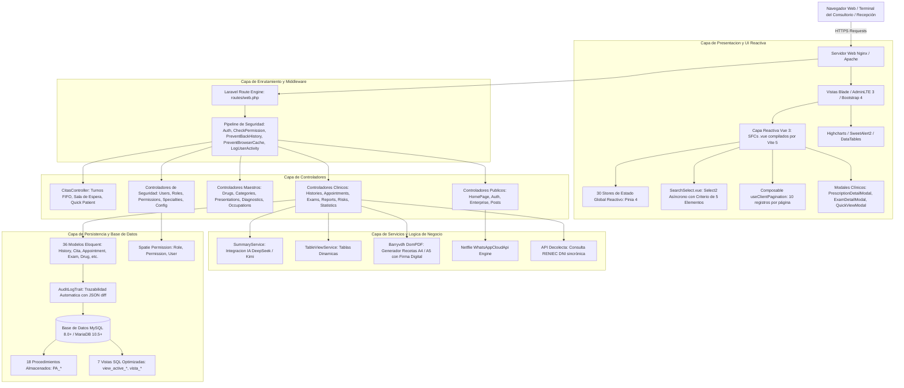
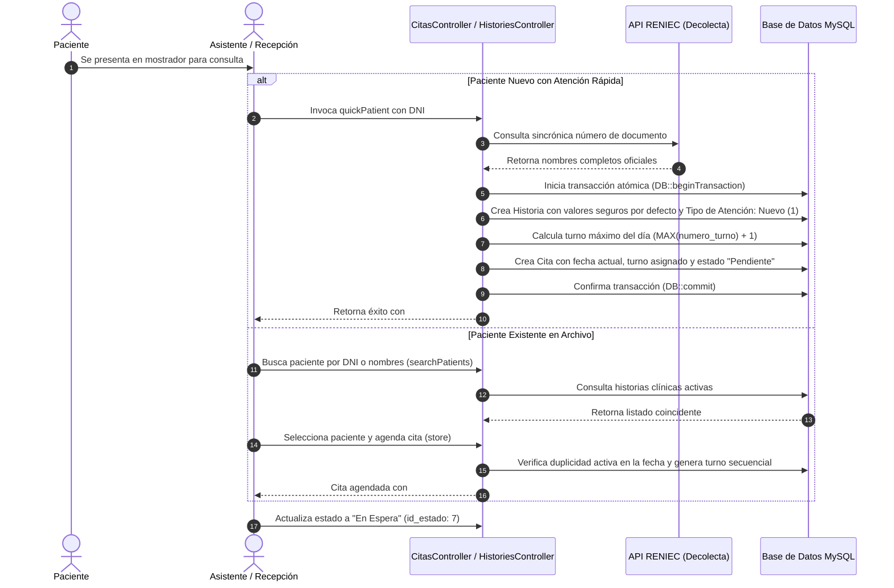
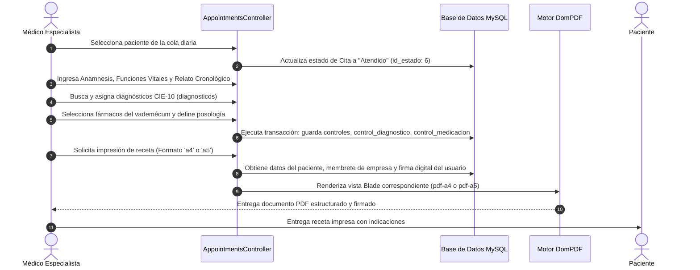

# PDR — Documento de Definición de Producto y Reporte de Arquitectura del Sistema

**Sistema:** Neumo-LAV / Neumotar (Gestión de Historias Clínicas Electrónicas, Diagnósticos Neumológicos Especializados, Control de Turnos en Sala de Espera y Salud Ocupacional)  
**Versión del Sistema:** 3.3.0 (Edición Corporativa y Asistencial con Arquitectura Reactiva Vue 3 / Pinia / Vite)  
**Entorno Tecnológico:** PHP 8.1+ (8.3 compatible) / Laravel Framework 10.x / Vue 3.5+ (Composition API & `<script setup>`) / Pinia 4.x / Vite 5.x / MySQL 8.0+ / MariaDB 10.5+ / AdminLTE 3 / Bootstrap 4  
**Entidad Propietaria:** Medytarq SAC (RUC: 20605677593)  
**Establecimiento:** Jr. Paraguay 136, Tarapoto, San Martín, Perú  

---

## Índice de Contenidos

- [1. Introducción y Visión General del Producto](#1-introducción-y-visión-general-del-producto)
  - [1.1 Propósito y Justificación Médica](#11-propósito-y-justificación-médica)
  - [1.2 Alcance Funcional y Clínico](#12-alcance-funcional-y-clínico)
  - [1.3 Perfiles de Usuario y Modelo de Roles (RBAC)](#13-perfiles-de-usuario-y-modelo-de-roles-rbac)
- [2. Arquitectura Tecnológica y Patrones de Diseño](#2-arquitectura-tecnológica-y-patrones-de-diseño)
  - [2.1 Diagrama de Arquitectura de Capas](#21-diagrama-de-arquitectura-de-capas)
  - [2.2 Flujos de Secuencia Clínica y Procesos Asistenciales](#22-flujos-de-secuencia-clínica-y-procesos-asistenciales)
  - [2.3 Pila Tecnológica y Dependencias Principales](#23-pila-tecnológica-y-dependencias-principales)
  - [2.4 Arquitectura Frontend Reactiva (Vue 3, Pinia y Vite)](#24-arquitectura-frontend-reactiva-vue-3-pinia-y-vite)
- [3. Capa de Seguridad, Autenticación, Credenciales y Auditoría](#3-capa-de-seguridad-autenticación-credenciales-y-auditoría)
  - [3.1 Control de Acceso y Pipeline de Middleware](#31-control-de-acceso-y-pipeline-de-middleware)
  - [3.2 Mecanismo Anti Fuerza Bruta y Protección de Sesión](#32-mecanismo-anti-fuerza-bruta-y-protección-de-sesión)
  - [3.3 Credenciales Médicas y Firma Digitalizada del Especialista](#33-credenciales-médicas-y-firma-digitalizada-del-especialista)
  - [3.4 Trazabilidad y Auditoría Transaccional Inmutable (`AuditLogTrait`)](#34-trazabilidad-y-auditoría-transaccional-inmutable-auditlogtrait)
- [4. Especificación Detallada de Módulos y Controladores](#4-especificación-detallada-de-módulos-y-controladores)
  - [4.1 Módulo Operativo: Citas, Turnos y Sala de Espera (`CitasController`)](#41-módulo-operativo-citas-turnos-y-sala-de-espera-citascontroller)
  - [4.2 Módulo Clínico: Historia Clínica Electrónica (`HistoriesController`)](#42-módulo-clínico-historia-clínica-electrónica-historiescontroller)
  - [4.3 Módulo Clínico: Controles Médicos y Recetas Duales A4/A5 (`AppointmentsController`)](#43-módulo-clínico-controles-médicos-y-recetas-duales-a4a5-appointmentscontroller)
  - [4.4 Módulo Clínico: Exámenes Auxiliares, Espirometría e Imagenología (`ExamsController`)](#44-módulo-clínico-exámenes-auxiliares-espirometría-e-imagenología-examscontroller)
  - [4.5 Módulo Clínico: Informes Médicos Formales (`ReportsController`)](#45-módulo-clínico-informes-médicos-formales-reportscontroller)
  - [4.6 Módulo Clínico: Informes de Riesgo Quirúrgico Neumológico (`RisksController`)](#46-módulo-clínico-informes-de-riesgo-quirúrgico-neumológico-riskscontroller)
  - [4.7 Módulo Estadístico y Analítica Epidemiológica (`StatisticsController`)](#47-módulo-estadístico-y-analítica-epidemiológica-statisticscontroller)
  - [4.8 Módulo de Mantenimiento y Catálogos Maestros](#48-módulo-de-mantenimiento-y-catálogos-maestros)
  - [4.9 Módulo de Seguridad y Administración de Usuarios y Roles](#49-módulo-de-seguridad-y-administración-de-usuarios-y-roles)
  - [4.10 Módulo de Gestión Empresarial y Contenidos CMS](#410-módulo-de-gestión-empresarial-y-contenidos-cms)
  - [4.11 Módulo Web Público y Portal de Reservas Omnicanal](#411-módulo-web-público-y-portal-de-reservas-omnicanal)
- [5. Servicios Especializados, Helpers y Validadores](#5-servicios-especializados-helpers-y-validadores)
  - [5.1 Integración RENIEC (Consulta DNI en Vivo)](#51-integración-reniec-consulta-dni-en-vivo)
  - [5.2 Motor de Notificaciones WhatsApp Cloud API](#52-motor-de-notificaciones-whatsapp-cloud-api)
  - [5.3 Servicio de Resumen Automatizado con IA (DeepSeek / Kimi AI)](#53-servicio-de-resumen-automatizado-con-ia-deepseek--kimi-ai)
  - [5.4 Motor de Renderizado de Recetas PDF (Formatos A4 y A5)](#54-motor-de-renderizado-de-recetas-pdf-formatos-a4-y-a5)
  - [5.5 Catálogo Exhaustivo de Form Requests (23 Validadores)](#55-catálogo-exhaustivo-de-form-requests-23-validadores)
  - [5.6 Catálogo de Recursos API (Eloquent Resources)](#56-catálogo-de-recursos-api-eloquent-resources)
- [6. Diccionario de Datos y Modelos Eloquent (36 Entidades)](#6-diccionario-de-datos-y-modelos-eloquent-36-entidades)
- [7. Catálogo de Procedimientos Almacenados y Vistas SQL](#7-catálogo-de-procedimientos-almacenados-y-vistas-sql)
  - [7.1 Procedimientos Almacenados (18 PA_*)](#71-procedimientos-almacenados-18-pa_)
  - [7.2 Vistas de Base de Datos Optimizadas (7 Vistas)](#72-vistas-de-base-de-datos-optimizadas-7-vistas)
- [8. Matriz Integral de Rutas del Sistema (85+ Rutas)](#8-matriz-integral-de-rutas-del-sistema-85-rutas)
- [9. Despliegue, Respaldos y Mantenimiento Operativo](#9-despliegue-respaldos-y-mantenimiento-operativo)
  - [9.1 Parámetros de Configuración del Entorno (.env)](#91-parámetros-de-configuración-del-entorno-env)
  - [9.2 Política y Automatización de Respaldos de Base de Datos](#92-política-y-automatización-de-respaldos-de-base-de-datos)
  - [9.3 Compilación y Despliegue de Activos Frontend (Vite)](#93-compilación-y-despliegue-de-activos-frontend-vite)
- [10. Historial de Versiones y Control de Cambios (SemVer)](#10-historial-de-versiones-y-control-de-cambios-semver)

---

## 1. Introducción y Visión General del Producto

### 1.1 Propósito y Justificación Médica
El software **Neumo-LAV** (denominado comercialmente en la atención al paciente como **Neumotar**) constituye una solución integral de alta especialización concebida para la gestión médica, asistencial, preventiva, ocupacional, epidemiológica y administrativa de la clínica de neumología y salud respiratoria operada por la sociedad **Medytarq SAC** en la ciudad de Tarapoto, Región San Martín, Perú.

La solución aborda de forma sistemática los requerimientos asistenciales del sector salud peruano (normativas y directivas del Ministerio de Salud - MINSA):
- **Cero Papel y Custodia Digital:** Supresión de expedientes físicos vulnerables al extravío, degradación biológica o manipulación no autorizada, garantizando custodia digital inalterable.
- **Estandarización Diagnóstica Internacional:** Integración de la codificación **CIE-10** en todos los actos médicos (controles, exámenes auxiliares, informes clínicos y peritajes).
- **Cálculo Objetivo de Carga Tabáquica:** Determinación algorítmica instantánea del **Índice Paquete Año (IPA)**:
  $$\text{IPA} = \frac{\text{Cigarrillos al día} \times \text{Años de consumo}}{20}$$
- **Vigilancia de Factores Ambientales de la Amazonía:** Registro sistemático de exposición doméstica a humo de biomasa/leña en cocina tradicional, polvos ocupacionales orgánicos e inorgánicos (minería, madereras, agroindustria) y antecedentes de tuberculosis (contacto TBC intradomiciliario) y secuelas de COVID-19.
- **Trazabilidad Farmacológica y Receta Médica Dual:** Generación automática de recetas médicas normalizadas en formatos **A4** (expediente formal) y **A5** (medio pliego para recetario de mostrador), con código de control, membrete corporativo y firma digitalizada del médico especialista con acreditación CMP y RNE.
- **Optimización de Sala de Espera y Turnos:** Flujo operativo automatizado bajo principio First-In, First-Out (FIFO) para el llamado de pacientes, control de tiempos de espera y clasificación del tipo de atención (`Nuevo`, `Control`, `Continuador`).

### 1.2 Alcance Funcional y Clínico
La plataforma abarca la totalidad del ciclo de atención del paciente ambulatorio y ocupacional:
1. **Admisión y Filiación Demográfica Asistida:** Consulta sincrónica a la base de datos de **RENIEC** mediante API REST Decolecta para el autocompletado fidedigno de identidad. Normalización territorial según los 1,874 distritos del **Ubigeo Nacional** y clasificación de ocupación bajo el estándar **CIUO**.
2. **Gestión de Turnos y Sala de Espera del Día:** Tablero interactivo en la vista principal (`/admin/home`) con semaforización de estados (`En Espera`, `Atendido`, `Cancelado`, `Reagendado`), filtro por fecha, buscador predictivo y registro express de pacientes (`quickPatient`).
3. **Historia Clínica Neumológica (HCL):** Anamnesis completa, tiempo de enfermedad, síntomas cardinales respiratorios (tos, disnea, dolor torácico, expectoración, hemoptisis), antecedentes mórbidos (asma bronquial, EPOC, EPID, TBC, cáncer pulmonar, efusión pleural, neumonías recurrentes) y encolamiento automático de citas en admisión.
4. **Controles Médicos y Consultas Asistenciales:** Registro evolutivo de cada cita médica, funciones vitales completas, formulación posológica detallada, visualización de historial (`/admin/appointments/see/{id}`) con paginación de cliente (10 registros por página) y modal interactivo de recetas (`PrescriptionDetailModal.vue`), además de impresión instantánea de recetas A4/A5 con firma médica digital.
5. **Exámenes Auxiliares de Diagnóstico:** Gestión de pruebas de función pulmonar (espirometría basal y con broncodilatador, FEV1, FVC, ratio FEV1/FVC), análisis de laboratorio y fluidos pleurales (ADA, PAP, cultivos, BK), con repositorio fotográfico y visor de imágenes radiológicas y trazados. Historial (`/admin/exams/see/{id}`) paginado (10 registros por página) y modal interactivo de examen (`ExamDetailModal.vue`).
6. **Informes Médicos e Informes de Riesgo Quirúrgico:** Emisión de dictámenes clínicos oficiales para empleadores, peritajes o trámites de salud pública, y evaluaciones de riesgo quirúrgico neumológico y cardiovascular preoperatorio. Ambas vistas (`reports/see/{id}` y `risks/see/{id}`) cuentan con paginación de 10 registros por página y modales dedicados de vista previa rápida.
7. **Analítica Epidemiológica y Drill-Down en Tiempo Real:** Tableros estadísticos interactivos desarrollados con Highcharts que visualizan morbilidad respiratoria, Top 15 de diagnósticos, Top 15 de medicamentos, métricas sociodemográficas y desglose mensual interactivo con un clic en el gráfico de producción anual.
8. **Arquitectura Reactiva con Vue 3 / Pinia / Vite:** Filtros estandarizados, componente Select2 asíncrono (`SearchSelect.vue`) con limitación inteligente de 5 resultados para no sobrecargar el servidor, y 30 stores reactivos para una interacción ultra-fluida.
9. **Portal Web y Reservas Omnicanal:** Portal web público con artículos de salud respiratoria y motor de solicitud de citas en línea con confirmación vía **WhatsApp Cloud API** y correo electrónico transaccional.

### 1.3 Perfiles de Usuario y Modelo de Roles (RBAC)
El sistema implementa el paquete `spatie/laravel-permission` estructurado en una matriz de tres roles institucionales:

| Rol | Identificador | Nivel de Acceso y Funciones |
| :--- | :--- | :--- |
| **Administrador** | `administrador` | Acceso global irrestricto. Gestión de usuarios, asignación de roles y permisos granulares mediante interfaz dual-panel, configuración institucional corporativa, gestión de copias de seguridad del sistema y acceso a todos los submódulos clínicos. |
| **Especialista** | `especialista` | Perfil médico (Neumólogo / Médico Cirujano). Acceso integral al circuito clínico: apertura y edición de historias clínicas, consultas y controles, exámenes auxiliares, carga de imágenes diagnósticas, emisión de informes clínicos y de riesgo quirúrgico, prescripción de recetas A4/A5, firma digitalizada y consulta del dashboard estadístico. |
| **Asistente** | `asistente` | Personal asistencial y de recepción. Permiso de consulta y creación de admisiones de pacientes, asignación de turnos en cola diaria FIFO, registro rápido de pacientes (`quickPatient`), cambio de estado en sala de espera (`En Espera`) y confirmación de turnos. Restringido para emisión de diagnósticos y prescripciones. |

---

## 2. Arquitectura Tecnológica y Patrones de Diseño

### 2.1 Diagrama de Arquitectura de Capas



### 2.2 Flujos de Secuencia Clínica y Procesos Asistenciales

#### Flujo 1: Admisión, Registro Rápido y Asignación de Turnos (FIFO)


#### Flujo 2: Consulta Médica, Prescripción y Receta Dual A4/A5


### 2.3 Pila Tecnológica y Dependencias Principales

| Categoría | Tecnología / Paquete | Versión | Propósito en la Solución |
| :--- | :--- | :--- | :--- |
| **Lenguaje Core** | PHP | `^8.1` / `8.3.6` | Motor de ejecución del servidor con soporte de tipado estricto y constructor promotion. |
| **Framework Web** | `laravel/framework` | `^10.10` | Arquitectura MVC, inyección de dependencias, Eloquent ORM, validación y migraciones. |
| **Framework Frontend Reactivo** | `vue` | `^3.5.43` | Reactividad declarativa, Single File Components (`.vue`), Composition API y `<script setup>`. |
| **Gestión de Estado Reactivo** | `pinia` | `^4.0.3` | Tienda de estado global y modular con 30 stores reactivos para cada dominio del sistema. |
| **Empaquetador y Bundler** | `vite` | `^5.0.0` | Servidor de compilación ultrarrápido con Hot Module Replacement (HMR) y generación de assets. |
| **Plugin Vue para Vite** | `@vitejs/plugin-vue` | `^6.0.10` | Compilación y transformación de SFCs de Vue en el pipeline de Vite. |
| **Integración Laravel-Vite** | `laravel-vite-plugin`| `^1.0.0` | Directivas Blade `@vite` para enlace y resolución automática de manifiesto de chunks. |
| **Cliente HTTP Frontend** | `axios` | `^1.20.0` | Cliente asíncrono para peticiones REST a controladores con manejo de CSRF token. |
| **Generador PDF** | `barryvdh/laravel-dompdf` | `^3.1` | Renderizado de documentos clínicos y recetas médicas duales (A4 / A5) con firma digital. |
| **Gestión de Permisos** | `spatie/laravel-permission` | `^6.21` | Implementación de RBAC en rutas, vistas y controladores con interfaz dual-panel. |
| **Copias de Seguridad** | `spatie/laravel-backup` | `^8.8` | Respaldo periódico programado de la base de datos y archivos multimedia de exámenes. |
| **Notificaciones WhatsApp** | `netflie/whatsapp-cloud-api`| `^2.2` | Conexión directa a Meta Cloud API para confirmación de citas del portal web. |
| **Cliente HTTP Backend** | `guzzlehttp/guzzle` | `^7.2` | Consultas HTTP a la API de RENIEC y a las APIs de IA (DeepSeek / Kimi). |
| **Machine Learning** | `php-ai/php-ml` | `^0.10.0` | Utilidades de predicción y análisis algorítmico en PHP. |
| **Autenticación API** | `laravel/sanctum` | `^3.3` | Emisión de tokens de autenticación para servicios móviles y API. |
| **UI Framework** | AdminLTE | `v3.2` | Plantilla administrativa basada en Bootstrap 4.6. |
| **Gráficos Estadísticos** | Highcharts JS | `v10+` | Renderizado de tableros epidemiológicos interactivos, series de tiempo y drilldown mensual. |
| **Tablas Dinámicas** | DataTables & JTable | `v1.10+` | Renderizado de listados paginados por AJAX con filtros avanzados y ordenamiento. |

### 2.4 Arquitectura Frontend Reactiva (Vue 3, Pinia y Vite)

El sistema ha evolucionado hacia un modelo híbrido en el que las vistas del servidor (Blade / AdminLTE 3) albergan componentes reactivos desarrollados en **Vue 3** y compilados a través de **Vite 5**:

#### 1. Configuración Modular de Vite (`vite.config.js`)
En lugar de un bundle monolítico, el archivo `vite.config.js` expone **29 puntos de entrada modulares** (`resources/js/modules/*.js`), permitiendo la carga condicional de JavaScript exclusivamente en las vistas donde se requiere (ej. `specialties.js`, `appointments-see.js`, `dashboard.js`, `quickview.js`, etc.).

#### 2. Gestión de Estado con Pinia (`resources/js/stores/`)
Se implementan **30 stores de Pinia** que desacoplan la lógica de presentación del consumo de datos:
- Manejo reactivo de loading (`loading`, `submitting`), paginación (`currentPage`, `pageSize`, `total`), términos de búsqueda y filtros.
- Acciones asíncronas para consumo de endpoints REST con Axios y propagación automática de cambios al DOM.

#### 3. Componente Select2 Asíncrono Reutilizable (`SearchSelect.vue`)
- Componente nativo de Vue 3 que emula y supera las capacidades de Select2 clásico.
- Soporta búsqueda asíncrona parametrizable (`:search-fn`), debounce configurable, navegación por teclado (`ArrowUp`, `ArrowDown`, `Enter`), botón de limpieza inmediata y resaltado de fragmentos coincidentes.
- Admite variantes de tamaño: `size="sm"` (altura fija de 31px para cabeceras y barras de filtros) y `size="md"` (para formularios modales).
- **Control de Sobrecarga del Servidor:** Integrado en filtros como el de Especialidades con un límite estricto de 5 elementos (`:max-results="5"` en frontend y `->limit(5)` en backend).

#### 4. Composables de Negocio (`resources/js/composables/`)
- `useClientPagination.js`: Encapsula la lógica de paginación en cliente para conjuntos de datos (historiales clínicos), fijando un estándar de **10 registros por página** con controles responsivos (anterior, siguiente, salto directo a página y contador de rango).
- `useHighcharts.js`: Abstrae la inicialización reactiva y redimensionamiento de gráficos epidemiológicos.
- `useTipoAtencionModal.js`: Gestiona el diálogo interactivo de cambio de tipo de atención (`Nuevo`, `Control`, `Continuador`).

#### 5. Modales Clínicos Especializados
- `PrescriptionDetailModal.vue`: Modal reactivo para visualización detallada de diagnósticos CIE-10 y posología de medicamentos en controles.
- `ExamDetailModal.vue`: Inspección de detalles de examen auxiliar, trazados y hallazgos.
- `ReportPreviewModal.vue`: Vista previa rápida de informes médicos.
- `RiskPreviewModal.vue`: Vista previa rápida de informes de riesgo quirúrgico.
- `QuickViewModal.vue`: Expediente rápido multisección en `/admin/home` y tablas de pacientes, con botones de acción interactivos ("Receta", "Ver", "Imprimir").

---

## 3. Capa de Seguridad, Autenticación, Credenciales y Auditoría

### 3.1 Control de Acceso y Pipeline de Middleware
El archivo [`app/Http/Kernel.php`](file:///media/gercova/DATA1/PROYECTOS%20WEB/neumo-lav/app/Http/Kernel.php) configura la secuencia de filtros obligatorios para cada solicitud HTTP:

```
[Cliente HTTP]
       │
       ▼
[Global Stack: TrustProxies -> PreventRequestsDuringMaintenance -> ValidatePostSize -> TrimStrings -> ConvertEmptyStringsToNull]
       │
       ▼
[Grupo 'web': EncryptCookies -> AddQueuedCookiesToResponse -> StartSession -> ShareErrorsFromSession -> VerifyCsrfToken -> SubstituteBindings]
       │
       ├─► [LogUserActivity] (Registra acceso en la tabla audit_logs)
       ├─► [PreventBrowserCacheAfterLogout] (Inyecta cabeceras No-Cache, No-Store, Must-Revalidate)
       │
       ▼
[Route Matching: Rutas protegidas bajo el prefijo /admin]
       │
       ├─► [auth] (Verifica sesión válida del usuario)
       ├─► [prevent.back] (Anula caché de historial del navegador para evitar navegar atrás post-logout)
       ├─► [role:administrador|especialista|asistente] (Verifica pertenencia al rol)
       └─► [permission:nombre_permiso] (Middleware personalizado CheckPermission)
```

#### Middleware `CheckPermission` ([`app/Http/Middleware/CheckPermission.php`](file:///media/gercova/DATA1/PROYECTOS%20WEB/neumo-lav/app/Http/Middleware/CheckPermission.php))
Permite evaluar listas de permisos utilizando separadores por coma o mediante el operador lógico pleca (`|`). Si el usuario autenticado posee al menos uno de los permisos declarados, se autoriza el paso; en caso contrario, se interrumpe la ejecución arrojando una excepción HTTP `403 (No tienes permiso para realizar esta acción)`.

#### Middleware `PreventBackHistory` y `PreventBrowserCacheAfterLogout`
Inyectan las cabeceras estándar de protección de privacidad médica en respuestas con contenido `text/html`:
```http
Cache-Control: no-cache, no-store, max-age=0, must-revalidate
Pragma: no-cache
Expires: Fri, 01 Jan 1990 00:00:00 GMT
```
Esto impide que una terminal compartida en el consultorio exponga historias clínicas o datos sensibles de pacientes al presionar el botón "Atrás" del navegador tras finalizar la sesión.

### 3.2 Mecanismo Anti Fuerza Bruta y Protección de Sesión
El controlador [`app/Http/Controllers/auth/AuthController.php`](file:///media/gercova/DATA1/PROYECTOS%20WEB/neumo-lav/app/Http/Controllers/auth/AuthController.php) resguarda el punto de entrada al sistema:
1. **Limitación de Tasa (Rate Limiting):** Se evalúa la llave criptográfica `throttleKey` conformada por la transliteración del correo electrónico y la dirección IP del cliente:
   ```php
   Str::transliterate(Str::lower($request->input('email')).'|'.$request->ip());
   ```
   Se autoriza un máximo de **5 intentos fallidos**. Superado dicho umbral, se bloquea la autenticación de manera progresiva por tiempo (`auth.throttle`).
2. **Filtrado de Usuarios Activos:** Se valida explícitamente que el usuario no cuente con una marca de baja lógica (`whereNull('deleted_at')`).
3. **Regeneración de Identificador de Sesión:** Tras validar las credenciales con `Auth::attempt()`, se ejecuta `$request->session()->regenerate()` para prevenir ataques de fijación de sesión (*Session Fixation*).
4. **Registro de Último Inicio de Sesión:** Se actualiza o crea un registro en la tabla `user_last_login` documentando la marca de tiempo `last_login` y la IP del cliente.
5. **Cierre de Sesión Seguro (`logout`):** Invalida completamente la sesión en el servidor (`$request->session()->invalidate()`) y regenera el token CSRF (`$request->session()->regenerateToken()`).

### 3.3 Credenciales Médicas y Firma Digitalizada del Especialista
En la gestión de usuarios y en el perfil personal del facultativo (`/admin/profile`, gestionado por `UsersController@profile` y `updateProfile`), se han integrado campos especializados:
- **Colegio Médico del Perú (CMP):** Almacenado en la columna `cmp` de la tabla `users`.
- **Registro Nacional de Especialista (RNE):** Almacenado en la columna `rne` de la tabla `users`.
- **Firma Digitalizada (`firma_digital`):** Carga segura de imagen de firma y sello en `storage/app/public/signatures/`.
  - El modelo `User` expone el accesor dinámico `digital_signature_url`, que verifica la existencia física en el disco `public` antes de generar la URL absoluta.
  - La firma se incrusta automáticamente en las recetas médicas (A4 y A5), informes clínicos y evaluaciones de riesgo quirúrgico.

### 3.4 Trazabilidad y Auditoría Transaccional Inmutable (`AuditLogTrait`)
El sistema implementa el trait [`app/Traits/AuditLogTrait.php`](file:///media/gercova/DATA1/PROYECTOS%20WEB/neumo-lav/app/Traits/AuditLogTrait.php) en los modelos clínicos y de seguridad (`History`, `Cita`, `Appointment`, `Exam`, `Report`, `Risk`, `User`). Intercepta automáticamente los eventos de Eloquent:
- `created`: Registra la acción `created`, el módulo, el identificador y el objeto creado en formato JSON en `new_data`.
- `updated`: Registra la acción `updated`, documentando en `old_data` los atributos modificados previos al cambio y en `new_data` los nuevos valores persistidos.
- `deleted`: Registra la acción `deleted` junto con el estado del registro inmediatamente antes de su baja lógica.
- Toda transacción almacena de forma inmutable el `user_id` autenticado, la dirección IP del cliente y el User-Agent del navegador en la tabla `audit_logs`.

---

## 4. Especificación Detallada de Módulos y Controladores

### 4.1 Módulo Operativo: Citas, Turnos y Sala de Espera (`CitasController`)
- **Controlador:** [`app/Http/Controllers/CitasController.php`](file:///media/gercova/DATA1/PROYECTOS%20WEB/neumo-lav/app/Http/Controllers/CitasController.php)
- **Modelos:** `Cita`, `History`, `AppointmentStatus`, `TipoAtencion`
- **Validadores:** `QuickPatientValidate`, `RescheduleValidate`
- **Vista Principal:** Integrada en [`resources/views/home/index.blade.php`](file:///media/gercova/DATA1/PROYECTOS%20WEB/neumo-lav/resources/views/home/index.blade.php) y motor JavaScript [`public/js/forms/citas.js`](file:///media/gercova/DATA1/PROYECTOS%20WEB/neumo-lav/public/js/forms/citas.js)

#### Funcionalidades y Acciones
1. `index(Request $request)`: Redirecciona al panel principal `home` conservando los parámetros de consulta por fecha.
2. `list(Request $request)`: Retorna la lista de citas del día para la tabla interactiva AJAX. Aplica ordenamiento secuencial FIFO (`COALESCE(numero_turno, 999999) ASC, created_at ASC`), genera badges coloreados del tipo de atención y renderiza el grupo de botones de acciones clínicas contextuales.
3. `stats(Request $request)`: Retorna los contadores estadísticos del día: total de citas, en espera (sala), atendidos, pendientes y cancelados.
4. `store(Request $request)`: Agenda una cita para un paciente existente. Valida que el paciente no tenga ya otra cita activa en la misma fecha (excluyendo canceladas). Asigna de forma automática el siguiente turno secuencial disponible para el día.
5. `quickPatient(QuickPatientValidate $request)`: Registra a un nuevo paciente con valores demográficos seguros y genera su primera cita con turno secuencial en una única transacción atómica (`DB::beginTransaction`).
6. `reschedule(RescheduleValidate $request, int $id)`: Reagenda una cita para una nueva fecha. Valida que el paciente no tenga otra cita activa en el día de destino, asigna un nuevo número de turno secuencial y actualiza el estado a `4 (Reagendado)`.
7. `updateStatus(Request $request, int $id)`: Modifica el estado de la cita (`En Espera`, `Atendido`, `Cancelado`, etc.).
8. `updateTipoAtencion(Request $request, int $id)`: Permite cambiar el tipo de atención (`1: Nuevo`, `2: Control`, `3: Continuador`), sincronizando el valor tanto en la cita como en la historia clínica del paciente.
9. `searchPatients(Request $request)`: Servicio de autocompletado predictivo para buscar pacientes por DNI o nombres al programar citas en mostrador.
10. `destroy(int $id)`: Ejecuta la eliminación lógica (soft delete) de la cita seleccionada.
11. **Modal de Resumen Rápido (`QuickViewModal.vue`):** Componente interactivo Vue 3 integrado en la barra de acciones de citas para consultar expediente en un clic. Incluye pestañas de filiación, antecedentes, controles previos y exámenes auxiliares, con botones de acción ("Receta", "Ver Examen" e "Imprimir") de alto contraste y vinculación directa a los modales de prescripción y detalle clínico.

---

### 4.2 Módulo Clínico: Historia Clínica Electrónica (`HistoriesController`)
- **Controlador:** [`app/Http/Controllers/hcl/HistoriesController.php`](file:///media/gercova/DATA1/PROYECTOS%20WEB/neumo-lav/app/Http/Controllers/hcl/HistoriesController.php)
- **Modelo:** [`app/Models/History.php`](file:///media/gercova/DATA1/PROYECTOS%20WEB/neumo-lav/app/Models/History.php)
- **Validador:** [`app/Http/Requests/HistoryValidate.php`](file:///media/gercova/DATA1/PROYECTOS%20WEB/neumo-lav/app/Http/Requests/HistoryValidate.php)
- **Vistas:** [`resources/views/hcl/histories/`](file:///media/gercova/DATA1/PROYECTOS%20WEB/neumo-lav/resources/views/hcl/histories) y componentes Vue en [`resources/js/components/histories/`](file:///media/gercova/DATA1/PROYECTOS%20WEB/neumo-lav/resources/js/components/histories)

#### Funcionalidades y Acciones
1. `index()`: Despliega el listado principal de pacientes administrado mediante JTable.
2. `list(Request $request)`: Consume la vista SQL `view_active_histories` para ofrecer paginación rápida por servidor (`jtStartIndex`, `jtPageSize`) con cálculo exacto de edad cronológica.
3. `add()` / `edit(History $history)`: Formularios de apertura y modificación de expediente, vinculando catálogos de Ubigeo, Ocupaciones CIUO, Grados de Instrucción, Grupos Sanguíneos y Tipos de Atención.
4. `store(HistoryValidate $request)`: Almacena o actualiza la historia clínica. Al registrar un nuevo paciente (`isNew`), calcula el IPA y encola automáticamente un registro en la tabla `citas` para la atención del día.
5. `searchDni(Request $request)`: Consulta sincrónica con RENIEC vía API REST Decolecta.
6. `searchLocation(Request $request)`: Búsqueda dinámica de Ubigeo territorial por código, departamento, provincia o distrito.
7. `searchOccupation(Request $request)`: Búsqueda predictiva de ocupaciones CIUO.
8. `quickView(int|string $id)`: Retorna un resumen JSON para la ventana modal reactiva de consulta rápida (`QuickViewModal.vue`), incorporando datos de filiación, signos vitales recientes y últimos exámenes/controles.
9. `destroy(History $hc)`: Eliminación lógica con verificación de integridad referencial.

---

### 4.3 Módulo Clínico: Controles Médicos y Recetas Duales A4/A5 (`AppointmentsController`)
- **Controlador:** [`app/Http/Controllers/hcl/AppointmentsController.php`](file:///media/gercova/DATA1/PROYECTOS%20WEB/neumo-lav/app/Http/Controllers/hcl/AppointmentsController.php)
- **Modelos:** `Appointment` (tabla `controles`), `DiagnosticAppointment`, `MedicationAppointment`, `Enterprise`
- **Validador:** [`app/Http/Requests/AppointmentValidate.php`](file:///media/gercova/DATA1/PROYECTOS%20WEB/neumo-lav/app/Http/Requests/AppointmentValidate.php)
- **Servicio:** [`app/Services/TableViewService.php`](file:///media/gercova/DATA1/PROYECTOS%20WEB/neumo-lav/app/Services/TableViewService.php)
- **Componentes Vue:** [`AppointmentsSeeTable.vue`](file:///media/gercova/DATA1/PROYECTOS%20WEB/neumo-lav/resources/js/components/appointments/AppointmentsSeeTable.vue), [`PrescriptionDetailModal.vue`](file:///media/gercova/DATA1/PROYECTOS%20WEB/neumo-lav/resources/js/components/shared/PrescriptionDetailModal.vue)

#### Funcionalidades y Acciones
1. `index()` / `see(History $hc)`: Panel de visualización de consultas y controles asociados a un paciente (`/admin/appointments/see/{hc}`).
   - **Paginación en Cliente (10 registros por página):** Implementada mediante el composable `useClientPagination.js`, permitiendo navegación rápida con botones anterior, siguiente, páginas directas y contador de registros.
   - **Modal Interactivo de Receta Médica (`PrescriptionDetailModal.vue`):** Permite inspeccionar en una ventana flotante el diagnóstico formal CIE-10 y la lista completa de medicamentos prescritos con posología (dosis, vía, frecuencia y duración), evitando saltos de pantalla o descargas innecesarias de PDF para revisión rápida.
2. `add(History $hc)` / `edit(Appointment $ap)`: Formularios de consulta clínica médica.
3. `store(AppointmentValidate $request)`: Transacción que persiste el control clínico, asocia diagnósticos CIE-10 (`control_diagnostico`) y prescribe medicamentos con posología (`control_medicacion`).
4. `viewDetail(Appointment $ap)`: Retorna la información clínica completa del control en formato JSON.
5. `listAppointments(History $hc)`: Invoca el procedimiento almacenado `PA_getAppointmentsByMedicalHistory`.
6. `listOfDiagnosticsByApp(Appointment $ap)`: Invoca el procedimiento `PA_getDiagnosticByAppointment`.
7. `listOfMedicationByApp(Appointment $ap)`: Invoca el procedimiento `PA_getMedicationByAppointment`.
8. `printPrescription(Appointment $ap, string $format = 'a5')`: Genera el documento PDF de la receta médica a través de DomPDF. Soporta formato `a4` (expediente clínico completo) o `a5` (recetario de mano), incrustando el membrete institucional de Medytarq SAC y la firma digitalizada del médico especialista con CMP y RNE.
9. `destroy(Appointment $ap)`: Eliminación lógica del control médico.
10. `destroyDiagnosticAppointment` / `destroyMedicationAppointment`: Eliminación individual de diagnósticos o prescripciones específicas de la consulta.

---

### 4.4 Módulo Clínico: Exámenes Auxiliares, Espirometría e Imagenología (`ExamsController`)
- **Controlador:** [`app/Http/Controllers/hcl/ExamsController.php`](file:///media/gercova/DATA1/PROYECTOS%20WEB/neumo-lav/app/Http/Controllers/hcl/ExamsController.php)
- **Modelos:** `Exam`, `ExamType`, `DiagnosticExam`, `MedicationExam`, `Imagen`
- **Validador:** [`app/Http/Requests/ExamValidate.php`](file:///media/gercova/DATA1/PROYECTOS%20WEB/neumo-lav/app/Http/Requests/ExamValidate.php)
- **Componentes Vue:** [`ExamsSeeTable.vue`](file:///media/gercova/DATA1/PROYECTOS%20WEB/neumo-lav/resources/js/components/exams/ExamsSeeTable.vue), [`ExamDetailModal.vue`](file:///media/gercova/DATA1/PROYECTOS%20WEB/neumo-lav/resources/js/components/exams/ExamDetailModal.vue)

#### Funcionalidades y Acciones
1. `index()` / `see(History $hc)`: Listado cronológico de exámenes auxiliares realizados al paciente (`/admin/exams/see/{hc}`).
   - **Paginación en Cliente (10 registros por página):** Implementada con `useClientPagination.js`.
   - **Modal Interactivo de Detalle de Examen (`ExamDetailModal.vue`):** Despliega parámetros del examen, diagnósticos, medicación y galería de imágenes médicas y trazados espirométricos.
2. `add(History $hc)` / `edit(Exam $ex)`: Registro de funciones vitales completas, examen físico general, paneles laboratoriales, fluidos pleurales (ADA, PAP, cultivos) y parámetros espirométricos (FEV1, FVC, FEV1/FVC basal y post-BD).
3. `store(ExamValidate $request)`: Guarda el examen, asocia diagnósticos CIE-10, fármacos administrados y procesa la carga múltiple de imágenes médicas (`imagenes`) almacenadas en `storage/app/public/exams/`.
4. `viewDetail(Exam $ex)`: Retorna el detalle clínico del examen mediante JSON.
5. `viewExamImage(Imagen $image)` / `listOfImagesByExam(Exam $ex)`: Consulta de trazados espirométricos y radiografías para el visor de imágenes integrado.
6. `printPrescription(Exam $ex, string $format = 'a5')`: Emisión de receta o constancia de examen auxiliar en PDF (A4 / A5).
7. `destroy(Exam $ex)` / `destroyExamImage(Imagen $ix)`: Eliminación lógica del examen o desvinculación individual de imágenes diagnósticas.

---

### 4.5 Módulo Clínico: Informes Médicos Formales (`ReportsController`)
- **Controlador:** [`app/Http/Controllers/hcl/ReportsController.php`](file:///media/gercova/DATA1/PROYECTOS%20WEB/neumo-lav/app/Http/Controllers/hcl/ReportsController.php)
- **Modelos:** `Report` (tabla `historia_informe`), `DiagnosticReport`, `History`
- **Validador:** [`app/Http/Requests/ReportValidate.php`](file:///media/gercova/DATA1/PROYECTOS%20WEB/neumo-lav/app/Http/Requests/ReportValidate.php)
- **Componentes Vue:** [`ReportsSeeTable.vue`](file:///media/gercova/DATA1/PROYECTOS%20WEB/neumo-lav/resources/js/components/reports/ReportsSeeTable.vue), [`ReportPreviewModal.vue`](file:///media/gercova/DATA1/PROYECTOS%20WEB/neumo-lav/resources/js/components/reports/ReportPreviewModal.vue)

#### Funcionalidades y Acciones
1. `index()` / `see(History $hc)`: Historial de informes médicos emitidos al paciente (`/admin/reports/see/{hc}`).
   - **Paginación en Cliente (10 registros por página):** Gestionada reactivamente con `useClientPagination.js`.
   - **Modal de Vista Previa de Informe (`ReportPreviewModal.vue`):** Despliega el resumen estructurado del dictamen antes de imprimir.
2. `add(History $hc)` / `edit(Report $rp)`: Formulario estructurado para emisión de dictámenes: antecedentes, historia de la enfermedad actual, examen físico, exámenes complementarios, correlación diagnóstica CIE-10, tratamiento y sugerencias.
3. `store(ReportValidate $request)`: Persistencia transaccional del informe y sus diagnósticos vinculados.
4. `listReports(History $hc)`: Invoca el procedimiento almacenado `PA_getReportsByMedicalHistory`.
5. `printReport(Request $request, Report $rp)`: Renderizado y descarga de informe clínico oficial en PDF con formato membretado, sellos institucionales y firma médica digitalizada.
6. `destroy(Report $rp)` / `destroyDiagnosticReport`: Anulación del informe o retiro de diagnósticos específicos.

---

### 4.6 Módulo Clínico: Informes de Riesgo Quirúrgico Neumológico (`RisksController`)
- **Controlador:** [`app/Http/Controllers/hcl/RisksController.php`](file:///media/gercova/DATA1/PROYECTOS%20WEB/neumo-lav/app/Http/Controllers/hcl/RisksController.php)
- **Modelos:** `Risk` (tabla `historia_riesgo`), `History`
- **Validador:** [`app/Http/Requests/RiskValidate.php`](file:///media/gercova/DATA1/PROYECTOS%20WEB/neumo-lav/app/Http/Requests/RiskValidate.php)
- **Componentes Vue:** [`RisksSeeTable.vue`](file:///media/gercova/DATA1/PROYECTOS%20WEB/neumo-lav/resources/js/components/risks/RisksSeeTable.vue), [`RiskPreviewModal.vue`](file:///media/gercova/DATA1/PROYECTOS%20WEB/neumo-lav/resources/js/components/risks/RiskPreviewModal.vue)

#### Funcionalidades y Acciones
1. `index()` / `see(History $hc)`: Listado de evaluaciones preoperatorias registradas (`/admin/risks/see/{hc}`).
   - **Paginación en Cliente (10 registros por página):** Gestionada reactivamente con `useClientPagination.js`.
   - **Modal de Vista Previa de Riesgo Quirúrgico (`RiskPreviewModal.vue`):** Permite inspeccionar la estratificación de riesgo, parámetros ventilatorios y recomendaciones perioperatorias.
2. `add(History $hc)` / `edit(Risk $rk)`: Formulario de valoración prequirúrgica: motivo de intervención, antecedentes cardiorrespiratorios, examen físico segmentario, pruebas de espirometría/gases arteriales, estratificación de riesgo neumológico (Bajo, Moderado, Alto) y recomendaciones anestésicas perioperatorias.
3. `store(RiskValidate $request)`: Guarda o actualiza la evaluación de riesgo.
4. `listRisks(History $hc)`: Invoca el procedimiento `PA_getRisksByMedicalHistory`.
5. `printRiskReport(Request $request, Risk $rk)`: Emisión del informe de riesgo preoperatorio en PDF para adjuntar a la historia quirúrgica del paciente.
6. `destroy(Risk $rk)`: Eliminación lógica del registro.

---

### 4.7 Módulo Estadístico y Analítica Epidemiológica (`StatisticsController`)
- **Controlador:** [`app/Http/Controllers/hcl/StatisticsController.php`](file:///media/gercova/DATA1/PROYECTOS%20WEB/neumo-lav/app/Http/Controllers/hcl/StatisticsController.php)
- **Vistas:** [`resources/views/hcl/statistics/index.blade.php`](file:///media/gercova/DATA1/PROYECTOS%20WEB/neumo-lav/resources/views/hcl/statistics/index.blade.php) y componentes Vue en [`resources/js/components/statistics/`](file:///media/gercova/DATA1/PROYECTOS%20WEB/neumo-lav/resources/js/components/statistics)

#### Endpoints y Métricas Epidemiológicas
1. `index()`: Vista principal del dashboard analítico.
2. `getCountRows()`: Métricas acumuladas: total de historias clínicas, exámenes auxiliares, citas de control y nuevos pacientes admitidos.
3. `HCByMonth()` / `getAnnualData($year)`: Serie temporal de 12 meses comparando el volumen mensual de historias clínicas y atenciones.
4. **Drill-Down Interactivo por Mes y Categoría (`ProductionReportChart.vue`):** Al interactuar con el gráfico de barras del "Reporte de Historias Clínicas" (producción de historias, exámenes y controles), hacer clic sobre cualquier barra permite profundizar inmediatamente hacia una vista mensual detallada de dicha categoría en el mes seleccionado. El gráfico incluye un botón largo y estilizado de "Volver al Reporte Anual" para restablecer la vista panorámica sin recargar la página.
5. `getDiagnosticsByExam()`: Ranking interactivo del **Top 15 de diagnósticos más frecuentes** en la práctica neumológica del centro.
6. `getDrugsByExam()`: Ranking interactivo del **Top 15 de fármacos respiratorios más recetados**.
7. `getHistoriesBySex()`: Distribución demográfica por sexo biológico (Masculino / Femenino).
8. `getHistoriesBySmoking()`: Distribución poblacional por consumo de tabaco consumiendo la vista `vista_tabaquismo`.
9. `getHistoriesByBloodingGroup()`: Distribución por grupo sanguíneo y factor Rh mediante `vista_grupo_sanguineo`.
10. `getHistoriesByMaritalStatus()`: Distribución por estado civil mediante `vista_estado_civil`.
11. `getHistoriesByDegreeIntruction()`: Distribución por nivel de instrucción educativa.

---

### 4.8 Módulo de Mantenimiento y Catálogos Maestros

| Controlador | Modelo Principal | Endpoint Base | Responsabilidad Funcional |
| :--- | :--- | :--- | :--- |
| [`CategoriesController`](file:///media/gercova/DATA1/PROYECTOS%20WEB/neumo-lav/app/Http/Controllers/maintenance/CategoriesController.php) | `Category` (`droga_categoria`) | `/admin/categories` | Gestión CRUD de familias farmacológicas (Broncodilatadores, Corticoides, etc.). |
| [`PresentationsController`](file:///media/gercova/DATA1/PROYECTOS%20WEB/neumo-lav/app/Http/Controllers/maintenance/PresentationsController.php) | `Presentation` (`droga_presentacion`) | `/admin/presentations` | Gestión CRUD de formas farmacéuticas (Inhalador MDI, Polvo seco DPI, Tabletas, Jarabes). |
| [`DrugsController`](file:///media/gercova/DATA1/PROYECTOS%20WEB/neumo-lav/app/Http/Controllers/maintenance/DrugsController.php) | `Drug` (`drogas`) | `/admin/drugs` | Vademécum activo de fármacos y concentraciones, consumiendo la vista SQL `view_active_drugs`. |
| [`DiagnosticsController`](file:///media/gercova/DATA1/PROYECTOS%20WEB/neumo-lav/app/Http/Controllers/maintenance/DiagnosticsController.php) | `Diagnostic` (`diagnosticos`) | `/admin/diagnostics` | Catálogo de enfermedades CIE-10 con búsqueda predictiva AJAX (`advancedSearch` y `autocomplete`). |
| [`OccupationsController`](file:///media/gercova/DATA1/PROYECTOS%20WEB/neumo-lav/app/Http/Controllers/maintenance/OccupationsController.php) | `Occupation` (`ocupaciones`) | `/admin/occupations` | Catálogo de ocupaciones CIUO para vigilancia de riesgos respiratorios en el trabajo. |

---

### 4.9 Módulo de Seguridad y Administración de Usuarios y Roles

#### [`UsersController`](file:///media/gercova/DATA1/PROYECTOS%20WEB/neumo-lav/app/Http/Controllers/security/UsersController.php)
- Gestión integral de usuarios con validación `UserValidate`.
- Visualización consolidada mediante la vista SQL `view_user_roles_last_login`.
- Asignación y revocación de roles Spatie Permission y permisos directos por usuario (`storePermission`).
- Reseteo administrativo de contraseñas mediante `storePassword` con `ResetPasswordValidate`.
- Submódulo **Mi Perfil (`profile.edit` / `profile.update`)**: Actualización de avatar, biografía, número de colegiatura médica (`cmp`), registro de especialista (`rne`) y carga de la firma digitalizada (`firma_digital`) utilizada en recetas e informes.

#### [`RolesController`](file:///media/gercova/DATA1/PROYECTOS%20WEB/neumo-lav/app/Http/Controllers/security/RolesController.php)
- Gestión CRUD de roles (`Role::updateOrCreate`).
- Panel dual modal para inspeccionar permisos disponibles y permisos asignados (`getPermissions`).
- Sincronización masiva de permisos mediante `syncPermissions(Request $request, int $id)`.
- Consulta de usuarios asignados al rol seleccionado (`getUsers`).

#### [`PermissionController`](file:///media/gercova/DATA1/PROYECTOS%20WEB/neumo-lav/app/Http/Controllers/security/PermissionController.php)
- Mantenimiento del catálogo de permisos granulares Spatie (`permiso_acceder`, `rol_acceder`, `control_crear`, etc.).

#### [`SpecialtiesController`](file:///media/gercova/DATA1/PROYECTOS%20WEB/neumo-lav/app/Http/Controllers/security/SpecialtiesController.php)
- **Mantenimiento y Filtrado Inteligente de Especialidades:**
  - `options()`: Retorna el catálogo de ocupaciones asociadas para los modales de especialidad.
  - `search(Request $request)`: Endpoint especializado para el componente Select2 (`SearchSelect.vue`). Realiza búsqueda parcial por descripción y **aplica una restricción estricta de 5 elementos (`->limit(5)`)** para garantizar tiempos de respuesta ultrarrápidos y evitar sobrecarga en el servidor de base de datos.
  - `list(Request $request)`: Soporta filtrado por `specialty_id` para acotar la tabla al registro seleccionado desde la cabecera.
  - **Filtro de Cabecera Estandarizado (`SpecialtiesFilters.vue`):** Implementa `SearchSelect.vue` con tamaño compacto (`size="sm"` de 31px de altura) integrado armónicamente con el grupo de búsqueda general.

---

### 4.10 Módulo de Gestión Empresarial y Contenidos CMS

#### [`EnterpriseController`](file:///media/gercova/DATA1/PROYECTOS%20WEB/neumo-lav/app/Http/Controllers/business/EnterpriseController.php)
- Administra los datos fiscales e institucionales de la empresa **Medytarq SAC**: Razón Social, RUC (20605677593), Dirección física, teléfonos, correos, coordenadas e iframe de Google Maps.
- Gestión modular de cuatro recursos gráficos independientes:
  1. `foto-representante`: Fotografía del director médico / representante legal.
  2. `logo`: Logotipo institucional principal (login y cabeceras web).
  3. `mini-logo`: Isotipo optimizado para la barra lateral contraída de AdminLTE.
  4. `logo-receta`: Logotipo en alta resolución optimizado para el membrete de recetas médicas y reportes PDF.

#### [`PostsController`](file:///media/gercova/DATA1/PROYECTOS%20WEB/neumo-lav/app/Http/Controllers/business/PostsController.php)
- Administrador de contenidos (CMS) para artículos educativos de salud respiratoria.
- Soporte para etiquetas temáticas, imágenes de cabecera, tipos de publicación y autor médico.
- Integración con el servicio `SummaryService` para generación asistida de resúmenes mediante IA.

---

### 4.11 Módulo Web Público y Portal de Reservas Omnicanal
- **Controlador:** [`app/Http/Controllers/web/HomePageController.php`](file:///media/gercova/DATA1/PROYECTOS%20WEB/neumo-lav/app/Http/Controllers/web/HomePageController.php)
- **Vistas:** [`resources/views/homepage/`](file:///media/gercova/DATA1/PROYECTOS%20WEB/neumo-lav/resources/views/homepage)

#### Funcionalidades Públicas
- `index()`: Página de inicio con presentación del centro médico, cartera de servicios respiratorios, equipo médico y últimos artículos del blog.
- `posts($tags = null)` / `show($url)`: Catálogo de artículos médicos con filtrado por etiquetas temáticas y lectura completa.
- `aboutus()`: Reseña institucional sobre la misión, visión y trayectoria de Neumotar / Medytarq SAC.
- `contact()` / `sendContact()`: Formulario de contacto y consultas.
- `storeMail(ReservationValidate $request)`: Motor de reservas de citas online. Persiste la solicitud en la tabla `reservations` y despacha el correo transaccional `CitaSolicitada` al área de admisión, permitiendo al mismo tiempo iniciar el contacto por WhatsApp Cloud API.

---

## 5. Servicios Especializados, Helpers y Validadores

### 5.1 Integración RENIEC (Consulta DNI en Vivo)
Implementada en `HistoriesController@searchDni`:
- Conecta vía cliente HTTP de Laravel con el servicio REST de **Decolecta** (`https://api.decolecta.com/v1/reniec/dni?numero={dni}`).
- Permite obtener de forma sincrónica el nombre y apellidos completos oficiales registrados en el Registro Nacional de Identificación y Estado Civil del Perú, eliminando errores de transcripción en historias clínicas.

### 5.2 Motor de Notificaciones WhatsApp Cloud API
Implementado en `HomePageController` haciendo uso del paquete `netflie/whatsapp-cloud-api`:
- Conecta directamente con la API Oficial de Meta / WhatsApp Cloud.
- Utiliza las credenciales de entorno `WHATSAPP_FROM_PHONE_NUMBER_ID` y `WHATSAPP_ACCESS_TOKEN`.
- Envía un mensaje estructurado al número de teléfono del paciente con el código de país `51` confirmando la reserva médica solicitada.

### 5.3 Servicio de Resumen Automatizado con IA (DeepSeek / Kimi AI)
Implementado en [`app/Services/SummaryService.php`](file:///media/gercova/DATA1/PROYECTOS%20WEB/neumo-lav/app/Services/SummaryService.php) y apoyado por el helper `generateMocSummary` en [`app/Helpers/SummaryHelper.php`](file:///media/gercova/DATA1/PROYECTOS%20WEB/neumo-lav/app/Helpers/SummaryHelper.php):
- **Estrategia de Fallback Dual:**
  1. Realiza una petición POST con timeout de 15 segundos hacia el endpoint de **DeepSeek API** (`DEEPSEEK_API_KEY`).
  2. Si la consulta falla o supera el tiempo límite, conmuta de forma automática hacia la API de **Kimi AI** (`https://api.kimi.ai/v1/summarize` con `KIMI_API_KEY`).
  3. Si ambos servicios son inaccesibles, retorna `null` controladamente sin provocar caídas en el sistema.
- **Propósito:** Generación de resúmenes concisos de artículos médicos, síntesis de antecedentes complejos o notas clínicas extensas.

### 5.4 Motor de Renderizado de Recetas PDF (Formatos A4 y A5)
Implementado en `AppointmentsController@printPrescription`:
- Utiliza la fachada `Barryvdh\DomPDF\Facade\Pdf`.
- Ofrece dos plantillas de renderizado:
  - `hcl.appointments.pdf-a4`: Formato A4 tradicional con márgenes amplios (10mm superior/inferior, 15mm laterales) para historias clínicas completas.
  - `hcl.appointments.pdf-a5`: Formato de recetario de bolsillo A5 con márgenes optimizados de 0.5mm, ideal para entrega inmediata de indicaciones farmacológicas en mostrador.
- Incorpora automáticamente los logotipos de alta resolución de Medytarq SAC y la firma digitalizada del médico especialista con CMP y RNE.
- Configuración de aislamiento y seguridad:
  - `isHtml5ParserEnabled`: `true`
  - `isRemoteEnabled`: `false` (Previene ataques de Server-Side Request Forgery - SSRF vía inclusión de recursos remotos en plantillas).
  - `chroot`: Restringido al directorio raíz del proyecto mediante `realpath(base_path())`.

### 5.5 Catálogo Exhaustivo de Form Requests (23 Validadores)

| Form Request | Ubicación | Reglas y Campos Clave Validados |
| :--- | :--- | :--- |
| `AppointmentValidate` | `app/Http/Requests/AppointmentValidate.php` | Valida campos clínicos del control: síntomas, diagnósticos CIE-10 y medicamentos prescritos. |
| `CategoryValidate` | `app/Http/Requests/CategoryValidate.php` | Valida descripción única de categoría farmacológica. |
| `DiagnosticValidate` | `app/Http/Requests/DiagnosticValidate.php` | Valida descripción y formato del diagnóstico CIE-10. |
| `DrugValidate` | `app/Http/Requests/DrugValidate.php` | Valida descripción del fármaco, categoría y presentación asociada. |
| `EnterpriseValidate` | `app/Http/Requests/EnterpriseValidate.php` | Valida razón social, RUC (11 dígitos), correo, teléfono y archivos gráficos. |
| `ExamValidate` | `app/Http/Requests/ExamValidate.php` | Valida tipo de examen, signos vitales, parámetros espirométricos y archivos de imagen. |
| `HistoryValidate` | `app/Http/Requests/HistoryValidate.php` | Valida DNI (8 dígitos), nombres, fecha de nacimiento, sexo, ubigeo y antecedentes. |
| `LoginValidate` | `app/Http/Requests/LoginValidate.php` | Valida formato de correo y presencia de contraseña. |
| `ModuleValidate` | `app/Http/Requests/ModuleValidate.php` | Valida nombre e icono del módulo. |
| `OccupationValidate` | `app/Http/Requests/OccupationValidate.php` | Valida código y descripción de ocupación CIUO. |
| `PermissionValidate` | `app/Http/Requests/PermissionValidate.php` | Valida nombre único de permiso Spatie y guard_name. |
| `PostValidate` | `app/Http/Requests/PostValidate.php` | Valida título, contenido, tipo de post, imagen destacada y etiquetas. |
| `PresentationValidate` | `app/Http/Requests/PresentationValidate.php` | Valida denominación de presentación farmacéutica. |
| `ProfileUpdateValidate` | `app/Http/Requests/ProfileUpdateValidate.php` | Valida nombre, biografía, CMP, RNE, archivo de avatar y archivo de firma digital. |
| `QuickPatientValidate` | `app/Http/Requests/QuickPatientValidate.php` | Valida DNI, nombres, fecha de nacimiento, sexo, teléfono, fecha y hora de cita para registro express. |
| `ReportValidate` | `app/Http/Requests/ReportValidate.php` | Valida anamnesis, examen físico, conclusiones y diagnósticos de informes clínicos. |
| `RescheduleValidate` | `app/Http/Requests/RescheduleValidate.php` | Valida fecha de destino futura o actual y formato de hora para reagendamiento de citas. |
| `ReservationValidate` | `app/Http/Requests/ReservationValidate.php` | Valida nombre, teléfono, correo y fecha de reserva desde la web pública. |
| `ResetPasswordValidate`| `app/Http/Requests/ResetPasswordValidate.php` | Valida longitud mínima (6 caracteres) y confirmación de nueva contraseña. |
| `RiskValidate` | `app/Http/Requests/RiskValidate.php` | Valida motivo quirúrgico, examen físico, riesgo neumológico y sugerencias perioperatorias. |
| `SpecialtyValidate` | `app/Http/Requests/SpecialtyValidate.php` | Valida denominación de la especialidad médica. |
| `SubmoduleValidate` | `app/Http/Requests/SubmoduleValidate.php` | Valida nombre, ruta y módulo padre de submódulos. |
| `UserValidate` | `app/Http/Requests/UserValidate.php` | Valida nombre de usuario, correo único, contraseña, rol y especialidad. |

### 5.6 Catálogo de Recursos API (Eloquent Resources)
- `CategoryResource`: Transformación estructurada de categorías farmacológicas.
- `DiagnosticResource`: Formateo de diagnósticos CIE-10 para respuestas AJAX.
- `DrugResource`: Presentación de vademécum activo.
- `ImageResource`: Metadatos y URL de imágenes médicas para el visor modal.
- `OccupationResource`: Formateo de oficios CIUO.
- `PresentationResource`: Presentación de formatos de medicamentos.

---

## 6. Diccionario de Datos y Modelos Eloquent (36 Entidades)

El sistema opera con **36 modelos Eloquent activos** en [`app/Models/`](file:///media/gercova/DATA1/PROYECTOS%20WEB/neumo-lav/app/Models):

| # | Modelo | Tabla | Clave Primaria | Rasgos (Traits) | Relaciones Principales | Descripción Funcional |
| :-: | :--- | :--- | :--- | :--- | :--- | :--- |
| 1 | `Appointment` | `controles` | `id` | SoftDeletes, AuditLogTrait | `belongsTo(History)`, `hasMany(DiagnosticAppointment)`, `hasMany(MedicationAppointment)` | Consultas y controles médicos clínicos, anamnesis y prescripción. |
| 2 | `AppointmentStatus` | `estado_cita` | `id` | — | `hasMany(Cita)` | Catálogo de estados de citas (`Pendiente`, `Atendido`, `Cancelado`, `En Espera`, `Reagendado`). |
| 3 | `AuditLog` | `audit_logs` | `id` | — | `belongsTo(User)` | Bitácora de accesos y modificaciones con JSON diff (`old_data`, `new_data`). |
| 4 | `BloodGroups` | `grupo_sanguineo` | `id` | — | `hasMany(History)` | Grupos sanguíneos y factores Rh (A+, O+, B-, etc.). |
| 5 | `Category` | `droga_categoria` | `id` | SoftDeletes | `hasMany(Drug)` | Familias y categorías farmacológicas de medicamentos. |
| 6 | `Cita` | `citas` | `id` | SoftDeletes, AuditLogTrait | `belongsTo(History)`, `belongsTo(AppointmentStatus)`, `belongsTo(TipoAtencion)` | Turnos del día, cola de atención FIFO, fecha, hora, estado y tipo de atención. |
| 7 | `DegreesInstruction` | `grado_instruccion` | `id` | — | `hasMany(History)` | Nivel educativo alcanzado por el paciente. |
| 8 | `Diagnostic` | `diagnosticos` | `id` | SoftDeletes | `hasMany(DiagnosticAppointment)`, `hasMany(DiagnosticExam)` | Catálogo de patologías según la codificación internacional CIE-10. |
| 9 | `DiagnosticAppointment`| `control_diagnostico`| `id` | SoftDeletes | `belongsTo(Appointment)`, `belongsTo(Diagnostic)` | Diagnósticos CIE-10 asignados en una consulta médica de control. |
| 10 | `DiagnosticExam` | `examen_diagnostico`| `id` | SoftDeletes | `belongsTo(Exam)`, `belongsTo(Diagnostic)` | Diagnóstico específico identificado durante un examen auxiliar. |
| 11 | `DiagnosticReport` | `informe_diagnostico`| `id`| SoftDeletes | `belongsTo(Report)`, `belongsTo(Diagnostic)` | Diagnósticos vinculados a un informe médico formal. |
| 12 | `DocumentType` | `tipo_documento` | `id` | — | `hasMany(History)` | Documentos de identidad oficiales (DNI, Carné de Extranjería, Pasaporte). |
| 13 | `Drug` | `drogas` | `id` | SoftDeletes | `belongsTo(Category)`, `belongsTo(Presentation)` | Vademécum de fármacos disponibles para prescripción médica. |
| 14 | `Enterprise` | `empresa` | `id` | — | — | Datos fiscales e institucionales de Medytarq SAC y 4 activos multimedia. |
| 15 | `Exam` | `examenes` | `id` | SoftDeletes, AuditLogTrait | `belongsTo(History)`, `belongsTo(ExamType)`, `hasMany(Imagen)` | Pruebas diagnósticas, espirometrías, signos vitales y fluidos pleurales. |
| 16 | `ExamType` | `tipo_examen` | `id` | — | `hasMany(Exam)` | Clasificación de exámenes auxiliares (Espirometría, TAC, Radiografía, etc.). |
| 17 | `History` | `historias` | `id` | HasFactory, SoftDeletes, AuditLogTrait | `hasMany(Appointment)`, `hasMany(Cita)`, `hasMany(Exam)`, `hasMany(Report)`, `hasMany(Risk)`, `belongsTo(TipoAtencion)` | Expediente clínico neumológico central, factores de riesgo, IPA y filiación. |
| 18 | `Imagen` | `imagenes` | `id` | SoftDeletes | `belongsTo(Exam)`, `belongsTo(History)` | Archivos gráficos de exámenes (radiografías, curvas espirométricas, TAC). |
| 19 | `MaritalStatus` | `estado_civil` | `id` | — | `hasMany(History)` | Estado civil del paciente. |
| 20 | `MedicationAppointment`| `control_medicacion`| `id` | SoftDeletes | `belongsTo(Appointment)`, `belongsTo(Drug)` | Medicamentos y posología prescritos en una consulta médica de control. |
| 21 | `MedicationExam` | `examen_medicacion` | `id` | SoftDeletes | `belongsTo(Exam)`, `belongsTo(Drug)` | Fármacos administrados durante o después de un examen auxiliar. |
| 22 | `Occupation` | `ocupaciones` | `id` | SoftDeletes | `hasMany(History)` | Oficios y profesiones según la clasificación CIUO. |
| 23 | `Post` | `post` | `id` | SoftDeletes | `belongsTo(User)`, `belongsTo(PostType)` | Artículos médicos y de salud pública publicados en el blog. |
| 24 | `PostType` | `post_type` | `id` | — | `hasMany(Post)` | Categorías temáticas de publicaciones informativas. |
| 25 | `Presentation` | `droga_presentacion`| `id` | SoftDeletes | `hasMany(Drug)` | Formas farmacéuticas (Inhalador MDI, Polvo seco DPI, Tabletas, Jarabes). |
| 26 | `Profile` | `perfiles` | `id` | — | `belongsTo(User)` | Perfiles complementarios de usuario en el sistema. |
| 27 | `Report` | `historia_informe` | `id` | SoftDeletes, AuditLogTrait | `belongsTo(History)`, `hasMany(DiagnosticReport)` | Informes médicos oficiales de neumología. |
| 28 | `Reservation` | `reservations` | `id` | — | — | Solicitudes de reserva de citas registradas desde el portal público. |
| 29 | `Risk` | `historia_riesgo` | `id` | SoftDeletes, AuditLogTrait | `belongsTo(History)` | Evaluaciones de riesgo quirúrgico pulmonar y cardiovascular. |
| 30 | `Sex` | `sexo` | `id` | — | `hasMany(History)` | Sexo biológico del paciente (`Masculino`, `Femenino`). |
| 31 | `Smoking` | `tabaquismo` | `id` | — | `hasMany(History)` | Categorías de consumo de tabaco (`No fumador`, `Exfumador`, `Fumador`). |
| 32 | `Specialty` | `especialidades` | `id` | SoftDeletes | `hasMany(User)` | Especialidades médicas de los profesionales (`Neumología`, etc.). |
| 33 | `TipoAtencion` | `tipos_atencion` | `id` | — | `hasMany(Cita)`, `hasMany(History)` | Catálogo de tipos de atención (`1: Nuevo`, `2: Control`, `3: Continuador`). |
| 34 | `UbigeoDistrict` | `ubigeo_distrito` | `id` | — | `hasMany(History)` | Distritos de la división político-administrativa del Perú (6 dígitos). |
| 35 | `User` | `users` | `id` | HasApiTokens, HasRoles, SoftDeletes, AuditLogTrait | `hasOne(Specialty)`, `hasOne(UserLastLogin)` | Cuentas de acceso, credenciales CMP/RNE y firma digitalizada. |
| 36 | `UserLastLogin` | `user_last_login` | `id` | — | `belongsTo(User)` | Registro de auditoría con la última fecha de login e IP por usuario. |

---

## 7. Catálogo de Procedimientos Almacenados y Vistas SQL

Para optimizar el rendimiento y evitar sobrecarga de consultas en tablas de gran volumen, la base de datos incorpora **18 Procedimientos Almacenados** y **7 Vistas SQL** nativas.

### 7.1 Procedimientos Almacenados (18 PA_*)

| Procedimiento Almacenado | Parámetros de Entrada | Conjunto de Datos Retornado | Uso en el Sistema |
| :--- | :--- | :--- | :--- |
| `PA_getAppointmentsByDni` | `IN p_dni VARCHAR(20)` | Citas médicas vinculadas al DNI, fechas, estados e identificadores. | Consultas rápidas por DNI en mostrador. |
| `PA_getAppointmentsByMedicalHistory` | `IN p_id_historia INT` | Listado histórico de citas ordenadas por fecha de atención. | `AppointmentsController@listAppointments` |
| `PA_getDiagnosticByAppointment` | `IN p_id_control INT` | Diagnósticos CIE-10 (código y descripción) asignados a una cita. | Vista de detalle de receta y controles. |
| `PA_getDiagnosticByExam` | `IN p_id_examen INT` | Diagnósticos asociados a un examen auxiliar o espirometría. | `ExamsController@viewDetail` |
| `PA_getDiagnosticByReport` | `IN p_id_informe INT` | Diagnósticos vinculados a un informe médico formal. | `ReportsController@viewReportDetail` |
| `PA_getExamsByDni` | `IN p_dni VARCHAR(20)` | Exámenes realizados a un paciente buscando por su DNI. | Búsqueda pericial en recepción. |
| `PA_getExamsByMedicalHistory` | `IN p_id_historia INT` | Relación cronológica de exámenes auxiliares del paciente. | `ExamsController@listExams` |
| `PA_getImgByExam` | `IN p_id_examen INT` | Rutas de archivos y metadatos de imágenes vinculadas a un examen. | Visor de imágenes radiológicas. |
| `PA_getMedicalHistoryByAppointment` | `IN p_id_control INT` | Datos del paciente (nombres, edad, DNI) a partir de la cita. | Membrete de impresión de receta médica. |
| `PA_getMedicalHistoryByExam` | `IN p_id_examen INT` | Datos del paciente a partir del identificador de examen. | Impresión de resultados de examen. |
| `PA_getMedicalHistoryByReport` | `IN p_id_informe INT` | Datos del paciente a partir del identificador de informe médico. | Impresión de informe clínico en PDF. |
| `PA_getMedicalHistoryByRisk` | `IN p_id_riesgo INT` | Datos del paciente a partir del identificador de riesgo quirúrgico. | Impresión de informe de riesgo en PDF. |
| `PA_getMedicationByAppointment` | `IN p_id_control INT` | Fármacos, presentaciones, dosis y posología de la cita médica. | Detalle de prescripción en receta médica. |
| `PA_getMedicationByExam` | `IN p_id_examen INT` | Medicación administrada durante o después de la prueba diagnóstica.| Detalle de examen auxiliar. |
| `PA_getReportsByDni` | `IN p_dni VARCHAR(20)` | Informes clínicos emitidos a un paciente buscando por su DNI. | Búsqueda rápida de informes emitidos. |
| `PA_getReportsByMedicalHistory` | `IN p_id_historia INT` | Historial de informes médicos ordenados descendentemente. | `ReportsController@listReports` |
| `PA_getRisksByDni` | `IN p_dni VARCHAR(20)` | Evaluaciones de riesgo quirúrgico vinculadas a un DNI. | Auditoría médica preoperatoria. |
| `PA_getRisksByMedicalHistory` | `IN p_id_historia INT` | Evaluaciones de riesgo vinculadas a la historia clínica. | `RisksController@listRisks` |

### 7.2 Vistas de Base de Datos Optimizadas (7 Vistas)
Definidas en la migración `2026_09_03_090013_create_report_views.php`:
1. `view_active_drugs`: Realiza un `JOIN` entre `drogas`, `droga_categoria` y `droga_presentacion` filtrando registros activos (`deleted_at IS NULL`). Alimenta los listados de vademécum en `DrugsController`.
2. `view_active_histories`: Proyecta los pacientes activos con su fecha de admisión, DNI, nombres en mayúsculas, cálculo matemático exacto de edad actual en base a la fecha de nacimiento y descripción de sexo. Alimenta el grid de `HistoriesController`.
3. `view_active_users`: Consolida los usuarios activos con su último inicio de sesión obtenido mediante subconsulta sobre `user_last_login`.
4. `view_user_roles_last_login`: Une la tabla de usuarios con `model_has_roles`, la tabla `roles` y la subconsulta de último login. Alimenta el listado de usuarios de `UsersController@list`.
5. `vista_estado_civil`: Conteo agrupado y descendente de pacientes clasificados por su estado civil para el dashboard analítico.
6. `vista_grupo_sanguineo`: Conteo agrupado y descendente de pacientes clasificados por su grupo sanguíneo y factor Rh.
7. `vista_tabaquismo`: Distribución de la población de pacientes según su grado de consumo de tabaco (`tabaquismo`).

---

## 8. Matriz Integral de Rutas del Sistema (85+ Rutas)

A continuación se documentan las rutas activas registradas en [`routes/web.php`](file:///media/gercova/DATA1/PROYECTOS%20WEB/neumo-lav/routes/web.php):

| Método HTTP | Patrón de URI | Nombre de Ruta | Controlador y Acción | Middleware Requerido | Permiso / Rol Exigido |
| :--- | :--- | :--- | :--- | :--- | :--- |
| `GET` | `/` | — | `HomePageController@index` | `web` | Público |
| `GET` | `/post/{url}` | `post.show` | `HomePageController@show` | `web` | Público |
| `GET` | `/posts/{tags?}` | `posts` | `HomePageController@posts` | `web` | Público |
| `GET` | `/nosotros` | `nosotros` | `HomePageController@aboutus` | `web` | Público |
| `GET` | `/contacto` | `contact` | `HomePageController@contact` | `web` | Público |
| `POST` | `/contacto` | `send-contact` | `HomePageController@sendContact` | `web` | Público |
| `POST` | `/sendmail` | `sendmail` | `HomePageController@storeMail` | `web` | Público |
| `GET` | `/login` | `login` | `AuthController@showLoginForm` | `web`, `guest` | Visitante no autenticado |
| `POST` | `/login` | — | `AuthController@login` | `web`, `guest` | Visitante no autenticado |
| `POST` | `/logout` | `logout` | `AuthController@logout` | `web`, `auth` | Usuario autenticado |
| `GET` | `/admin/home` | `home` | `HomeController@index` | `auth`, `prevent.back` | Autenticado |
| `GET` | `/admin/entreprise/dataEnterprise` | — | `EnterpriseController@getEnterprise` | `auth`, `prevent.back` | Autenticado |
| `GET` | `/admin/enterprise/images` | — | `EnterpriseController@getImages` | `auth`, `prevent.back` | Autenticado |
| `GET` | `/admin/histories/quotes/{hc}` | — | `HistoriesController@addQuotes` | `auth`, `prevent.back` | Autenticado |
| `GET` | `/admin/qoutes` | — | `HistoriesController@getQuotes` | `auth`, `prevent.back` | Autenticado |
| `GET` | `/admin/checkStatusPatient/{id}` | — | `HistoriesController@checkStatusPatient` | `auth`, `prevent.back` | Autenticado |
| `GET` | `/admin/histories/quick-view/{id}`| `hcl.histories.quickView`| `HistoriesController@quickView` | `auth`, `prevent.back` | Autenticado |
| `GET` | `/admin/profile` | `profile.edit` | `UsersController@profile` | `auth`, `prevent.back` | Autenticado |
| `POST` | `/admin/profile` | `profile.update` | `UsersController@updateProfile` | `auth`, `prevent.back` | Autenticado |
| `GET` | `/admin/citas` | `citas.index` | `CitasController@index` | `auth`, `prevent.back` | Autenticado |
| `GET` | `/admin/citas/list` | `citas.list` | `CitasController@list` | `auth`, `prevent.back` | Autenticado |
| `GET` | `/admin/citas/stats` | `citas.stats` | `CitasController@stats` | `auth`, `prevent.back` | Autenticado |
| `GET` | `/admin/citas/search-patients` | `citas.searchPatients`| `CitasController@searchPatients`| `auth`, `prevent.back` | Autenticado |
| `POST` | `/admin/citas/store` | `citas.store` | `CitasController@store` | `auth`, `prevent.back` | Autenticado |
| `POST` | `/admin/citas/quick-patient` | `citas.quickPatient`| `CitasController@quickPatient` | `auth`, `prevent.back` | Autenticado |
| `POST` | `/admin/citas/{id}/reschedule` | `citas.reschedule`| `CitasController@reschedule` | `auth`, `prevent.back` | Autenticado |
| `POST` | `/admin/citas/{id}/status` | `citas.updateStatus`| `CitasController@updateStatus` | `auth`, `prevent.back` | Autenticado |
| `POST` | `/admin/citas/{id}/tipo-atencion`| `citas.updateTipoAtencion`| `CitasController@updateTipoAtencion`| `auth`, `prevent.back` | Autenticado |
| `DELETE`| `/admin/citas/{id}` | `citas.destroy` | `CitasController@destroy` | `auth`, `prevent.back` | Autenticado |
| `GET` | `/admin/roles` | `security.roles` | `RolesController@index` | `auth`, `prevent.back` | `role:administrador`, `perm:seguridad`, `perm:roles` |
| `GET` | `/admin/roles/list` | — | `RolesController@list` | `auth`, `prevent.back` | `role:administrador`, `perm:seguridad`, `perm:roles` |
| `GET` | `/admin/roles/{id}/permissions` | — | `RolesController@getPermissions` | `auth`, `prevent.back` | `role:administrador`, `perm:seguridad`, `perm:roles` |
| `GET` | `/admin/roles/{id}/users` | — | `RolesController@getUsers` | `auth`, `prevent.back` | `role:administrador`, `perm:seguridad`, `perm:roles` |
| `GET` | `/admin/roles/{id}` | — | `RolesController@show` | `auth`, `prevent.back` | `role:administrador`, `perm:seguridad`, `perm:roles` |
| `POST` | `/admin/roles/store` | — | `RolesController@store` | `auth`, `prevent.back` | `role:administrador`, `perm:seguridad`, `perm:roles` |
| `POST` | `/admin/roles/{id}/syncPermissions`| `security.roles.syncPermissions`| `RolesController@syncPermissions`| `auth`, `prevent.back`| `role:administrador`, `perm:seguridad`, `perm:roles` |
| `DELETE`| `/admin/roles/delete/{id}` | — | `RolesController@destroy` | `auth`, `prevent.back` | `role:administrador`, `perm:seguridad`, `perm:roles` |
| `GET` | `/admin/permissions` | `security.permissions` | `PermissionController@index` | `auth`, `prevent.back` | `role:administrador`, `perm:seguridad`, `perm:permisos` |
| `GET` | `/admin/permissions/list` | — | `PermissionController@list` | `auth`, `prevent.back` | `role:administrador`, `perm:seguridad`, `perm:permisos` |
| `GET` | `/admin/permissions/{id}` | — | `PermissionController@show` | `auth`, `prevent.back` | `role:administrador`, `perm:seguridad`, `perm:permisos` |
| `POST` | `/admin/permissions/store` | — | `PermissionController@store` | `auth`, `prevent.back` | `role:administrador`, `perm:seguridad`, `perm:permisos` |
| `POST` | `/admin/permissions/search` | — | `PermissionController@search` | `auth`, `prevent.back` | `role:administrador`, `perm:seguridad`, `perm:permisos` |
| `DELETE`| `/admin/permissions/delete/{id}` | — | `PermissionController@destroy` | `auth`, `prevent.back` | `role:administrador`, `perm:seguridad`, `perm:permisos` |
| `GET` | `/admin/specialties` | `security.specialties` | `SpecialtiesController@index` | `auth`, `prevent.back` | `role:administrador`, `perm:seguridad`, `perm:especialidades`|
| `GET` | `/admin/specialties/list` | — | `SpecialtiesController@list` | `auth`, `prevent.back` | `role:administrador`, `perm:seguridad`, `perm:especialidades`|
| `GET` | `/admin/specialties/options` | — | `SpecialtiesController@options` | `auth`, `prevent.back` | `role:administrador`, `perm:seguridad`, `perm:especialidades`|
| `GET` | `/admin/specialties/search` | `security.specialties.search` | `SpecialtiesController@search` | `auth`, `prevent.back` | `role:administrador`, `perm:seguridad`, `perm:especialidades`, `perm:especialidad_ver`|
| `GET` | `/admin/specialties/{id}` | — | `SpecialtiesController@show` | `auth`, `prevent.back` | `role:administrador`, `perm:seguridad`, `perm:especialidades`|
| `POST` | `/admin/specialties/store` | — | `SpecialtiesController@store` | `auth`, `prevent.back` | `role:administrador`, `perm:seguridad`, `perm:especialidades`|
| `DELETE`| `/admin/specialties/delete/{id}` | — | `SpecialtiesController@destroy` | `auth`, `prevent.back` | `role:administrador`, `perm:seguridad`, `perm:especialidades`|
| `GET` | `/admin/users/home` | `security.users.home` | `UsersController@index` | `auth`, `prevent.back` | `role:administrador`, `perm:seguridad`, `perm:usuarios` |
| `GET` | `/admin/users/add` | `security.users.add` | `UsersController@add` | `auth`, `prevent.back` | `role:administrador`, `perm:seguridad`, `perm:usuarios` |
| `GET` | `/admin/users/edit/{id}` | `security.users.edit` | `UsersController@edit` | `auth`, `prevent.back` | `role:administrador`, `perm:seguridad`, `perm:usuarios` |
| `GET` | `/admin/users/role/{id}` | `security.users.role` | `UsersController@permissions` | `auth`, `prevent.back` | `role:administrador`, `perm:seguridad`, `perm:usuarios` |
| `GET` | `/admin/users/list` | — | `UsersController@list` | `auth`, `prevent.back` | `role:administrador`, `perm:seguridad`, `perm:usuarios` |
| `GET` | `/admin/users/{id}` | — | `UsersController@show` | `auth`, `prevent.back` | `role:administrador`, `perm:seguridad`, `perm:usuarios` |
| `POST` | `/admin/users/store` | — | `UsersController@store` | `auth`, `prevent.back` | `role:administrador`, `perm:seguridad`, `perm:usuarios` |
| `POST` | `/admin/users/storePassword/{user}` | — | `UsersController@storePassword` | `auth`, `prevent.back` | `role:administrador`, `perm:seguridad`, `perm:usuarios` |
| `POST` | `/admin/users/storePermission/{user}` | `securty.users.storePermission`| `UsersController@storePermission`| `auth`, `prevent.back` | `role:administrador`, `perm:seguridad`, `perm:usuarios` |
| `DELETE`| `/admin/users/delete/{id}` | — | `UsersController@destroy` | `auth`, `prevent.back` | `role:administrador`, `perm:seguridad`, `perm:usuarios` |
| `GET` | `/admin/histories/home` | `hcl.histories.home` | `HistoriesController@index` | `auth`, `prevent.back` | `permission:historias`, `permission:historia_acceder` |
| `GET` | `/admin/histories/add` | `hcl.histories.add` | `HistoriesController@add` | `auth`, `prevent.back` | `permission:historias`, `permission:historia_crear` |
| `GET` | `/admin/histories/edit/{history}`| `hcl.histories.edit` | `HistoriesController@edit` | `auth`, `prevent.back` | `permission:historias`, `permission:historia_actualizar` |
| `POST` | `/admin/histories/location` | — | `HistoriesController@searchLocation` | `auth`, `prevent.back` | `permission:historias` |
| `POST` | `/admin/histories/occupation` | — | `HistoriesController@searchOccupation` | `auth`, `prevent.back` | `permission:historias` |
| `POST` | `/admin/histories/dni` | — | `HistoriesController@searchDni` | `auth`, `prevent.back` | `permission:historias` |
| `POST` | `/admin/histories/store` | — | `HistoriesController@store` | `auth`, `prevent.back` | `permission:historias`, `permission:historia_crear` |
| `POST` | `/admin/histories/list` | — | `HistoriesController@list` | `auth`, `prevent.back` | `permission:historias`, `permission:historia_ver` |
| `DELETE`| `/admin/histories/{hc}` | — | `HistoriesController@destroy` | `auth`, `prevent.back` | `permission:historias`, `permission:historia_borrar` |
| `GET` | `/admin/exams/home` | `hcl.exams.home` | `ExamsController@index` | `auth`, `prevent.back` | `permission:examenes`, `permission:examen_acceder` |
| `GET` | `/admin/exams/add/{hc}` | `hcl.exams.add` | `ExamsController@add` | `auth`, `prevent.back` | `permission:examenes`, `permission:examen_crear` |
| `GET` | `/admin/exams/edit/{ex}` | `hcl.exams.edit` | `ExamsController@edit` | `auth`, `prevent.back` | `permission:examenes`, `permission:examen_crear` |
| `GET` | `/admin/exams/see/{hc}` | `hcl.exams.see` | `ExamsController@see` | `auth`, `prevent.back` | `permission:examenes`, `permission:examen_ver` |
| `POST` | `/admin/exams/store` | — | `ExamsController@store` | `auth`, `prevent.back` | `permission:examenes`, `permission:examen_crear` |
| `GET` | `/admin/exams/viewDetail/{ex}` | — | `ExamsController@viewDetail` | `auth`, `prevent.back` | `permission:examenes`, `permission:examen_ver` |
| `GET` | `/admin/exams/viewImg/{image}` | — | `ExamsController@viewExamImage` | `auth`, `prevent.back` | `permission:examenes` |
| `GET` | `/admin/exams/list/{hc}` | — | `ExamsController@listExams` | `auth`, `prevent.back` | `permission:examenes`, `permission:examen_ver` |
| `GET` | `/admin/exams/listDiagnostic/{ex}`| — | `ExamsController@listOfDiagnosticsByExam`| `auth`, `prevent.back` | `permission:examenes` |
| `GET` | `/admin/exams/listMedication/{ex}`| — | `ExamsController@listOfMedicationByExam`| `auth`, `prevent.back` | `permission:examenes` |
| `GET` | `/admin/exams/listImg/{ex}` | — | `ExamsController@listOfImagesByExam` | `auth`, `prevent.back` | `permission:examenes` |
| `GET` | `/admin/exams/print/{ex}/{format}`| `hcl.exams.print` | `ExamsController@printPrescription` | `auth`, `prevent.back` | `permission:examenes` |
| `DELETE`| `/admin/exams/delete/{ex}` | — | `ExamsController@destroy` | `auth`, `prevent.back` | `permission:examenes`, `permission:examen_borrar` |
| `DELETE`| `/admin/ex-dx/delete/{dx}` | — | `ExamsController@destroyExamDiagnostic` | `auth`, `prevent.back` | `permission:examenes`, `permission:examen_borrar` |
| `DELETE`| `/admin/ex-mx/delete/{mx}` | — | `ExamsController@destroyPrescriptionDrug`| `auth`, `prevent.back` | `permission:examenes`, `permission:examen_borrar` |
| `DELETE`| `/admin/ex-img/delete/{ix}` | — | `ExamsController@destroyExamImage` | `auth`, `prevent.back` | `permission:examenes`, `permission:examen_borrar` |
| `GET` | `/admin/appointments/home` | `hcl.appointments.home`| `AppointmentsController@index` | `auth`, `prevent.back` | `permission:controles`, `permission:control_acceder` |
| `GET` | `/admin/appointments/add/{hc}` | `hcl.appointments.add` | `AppointmentsController@add` | `auth`, `prevent.back` | `permission:controles`, `permission:control_crear` |
| `GET` | `/admin/appointments/edit/{ap}`| `hcl.appointments.edit`| `AppointmentsController@edit` | `auth`, `prevent.back` | `permission:controles`, `permission:control_actualizar` |
| `GET` | `/admin/appointments/see/{hc}` | `hcl.appointments.see` | `AppointmentsController@see` | `auth`, `prevent.back` | `permission:controles`, `permission:control_ver` |
| `GET` | `/admin/appointments/viewDetail/{ap}`| — | `AppointmentsController@viewDetail` | `auth`, `prevent.back` | `permission:controles`, `permission:control_ver` |
| `GET` | `/admin/appointments/list/{hc}` | — | `AppointmentsController@listAppointments`| `auth`, `prevent.back` | `permission:controles`, `permission:control_ver` |
| `GET` | `/admin/appointments/listAppointments/{ap}`| — | `AppointmentsController@listAppointmentsByHC`| `auth`, `prevent.back` | `permission:controles` |
| `GET` | `/admin/appointments/listDiagnostic/{ap}`| — | `AppointmentsController@listOfDiagnosticsByApp`| `auth`, `prevent.back` | `permission:controles` |
| `GET` | `/admin/appointments/listMedication/{ap}`| — | `AppointmentsController@listOfMedicationByApp`| `auth`, `prevent.back` | `permission:controles` |
| `POST` | `/admin/appointments/view-table`| — | `AppointmentsController@viewTable` | `auth`, `prevent.back` | `permission:controles` |
| `GET` | `/admin/appointments/print/{ap}/{format}`| `hcl.appointments.print`| `AppointmentsController@printPrescription`| `auth`, `prevent.back` | `permission:controles` |
| `POST` | `/admin/appointments/store` | — | `AppointmentsController@store` | `auth`, `prevent.back` | `permission:controles`, `permission:control_crear` |
| `DELETE`| `/admin/appointments/delete/{ap}`| — | `AppointmentsController@destroy` | `auth`, `prevent.back` | `permission:controles`, `permission:control_borrar` |
| `DELETE`| `/admin/ap-dx/delete/{dx}` | — | `AppointmentsController@destroyDiagnosticAppointment`| `auth`, `prevent.back` | `permission:controles`, `permission:control_borrar` |
| `DELETE`| `/admin/ap-mx/delete/{mx}` | — | `AppointmentsController@destroyMedicationAppointment`| `auth`, `prevent.back` | `permission:controles`, `permission:control_borrar` |
| `GET` | `/admin/reports/home` | `hcl.reports.home` | `ReportsController@index` | `auth`, `prevent.back` | `permission:informes`, `permission:informe_acceder` |
| `GET` | `/admin/reports/add/{hc}` | `hcl.reports.add` | `ReportsController@add` | `auth`, `prevent.back` | `permission:informes`, `permission:informe_crear` |
| `GET` | `/admin/reports/edit/{rp}` | `hcl.reports.edit` | `ReportsController@edit` | `auth`, `prevent.back` | `permission:informes`, `permission:informe_actualizar` |
| `GET` | `/admin/reports/see/{hc}` | `hcl.reports.see` | `ReportsController@see` | `auth`, `prevent.back` | `permission:informes`, `permission:informe_ver` |
| `POST` | `/admin/reports/store` | — | `ReportsController@store` | `auth`, `prevent.back` | `permission:informes`, `permission:informe_crear` |
| `GET` | `/admin/reports/viewDetail/{rp}`| — | `ReportsController@viewReportDetail` | `auth`, `prevent.back` | `permission:informes`, `permission:informe_ver` |
| `GET` | `/admin/reports/list/{hc}` | — | `ReportsController@listReports` | `auth`, `prevent.back` | `permission:informes`, `permission:informe_ver` |
| `GET` | `/admin/reports/listReports/{hc}`| — | `ReportsController@listReportsByDNI` | `auth`, `prevent.back` | `permission:informes` |
| `GET` | `/admin/reports/listDiagnostic/{rp}`| — | `ReportsController@listOfDiagnosticsByReport`| `auth`, `prevent.back`| `permission:informes` |
| `GET` | `/admin/reports/print/{rp}` | `hcl.reports.print` | `ReportsController@printReport` | `auth`, `prevent.back` | `permission:informes` |
| `DELETE`| `/admin/reports/delete/{rp}` | — | `ReportsController@destroy` | `auth`, `prevent.back` | `permission:informes`, `permission:informe_borrar` |
| `DELETE`| `/admin/rp-dx/delete/{dx}` | — | `ReportsController@destroyDiagnosticReport`| `auth`, `prevent.back` | `permission:informes`, `permission:informe_borrar` |
| `GET` | `/admin/risks/home` | `hcl.risks.home` | `RisksController@index` | `auth`, `prevent.back` | `permission:riesgos`, `permission:riesgo_acceder` |
| `GET` | `/admin/risks/add/{hc}` | `hcl.risks.add` | `RisksController@add` | `auth`, `prevent.back` | `permission:riesgos`, `permission:riesgo_crear` |
| `GET` | `/admin/risks/edit/{rk}` | `hcl.risks.edit` | `RisksController@edit` | `auth`, `prevent.back` | `permission:riesgos`, `permission:riesgo_actualizar` |
| `GET` | `/admin/risks/see/{hc}` | `hcl.risks.see` | `RisksController@see` | `auth`, `prevent.back` | `permission:riesgos`, `permission:riesgo_ver` |
| `GET` | `/admin/risks/viewDetail/{rk}` | — | `RisksController@viewRiskDetail` | `auth`, `prevent.back` | `permission:riesgos`, `permission:riesgo_ver` |
| `GET` | `/admin/risks/list/{hc}` | — | `RisksController@listRisks` | `auth`, `prevent.back` | `permission:riesgos`, `permission:riesgo_ver` |
| `GET` | `/admin/risks/listRisks/{hc}` | — | `RisksController@listRisksByDNI` | `auth`, `prevent.back` | `permission:riesgos`, `permission:riesgo_ver` |
| `GET` | `/admin/risks/print/{rk}` | `hcl.risks.print` | `RisksController@printRiskReport` | `auth`, `prevent.back` | `permission:riesgos` |
| `POST` | `/admin/risks/store` | — | `RisksController@store` | `auth`, `prevent.back` | `permission:riesgos`, `permission:riesgo_crear` |
| `DELETE`| `/admin/risks/delete/{rk}` | — | `RisksController@destroy` | `auth`, `prevent.back` | `permission:riesgos`, `permission:riesgo_borrar` |
| `GET` | `/admin/categories` | `maintenance.categories`| `CategoriesController@index` | `auth`, `prevent.back` | `permission:categorias`, `permission:categoria_acceder` |
| `GET` | `/admin/categories/list` | — | `CategoriesController@list` | `auth`, `prevent.back` | `permission:categorias`, `permission:categoria_ver` |
| `GET` | `/admin/categories/{cat}` | — | `CategoriesController@show` | `auth`, `prevent.back` | `permission:categorias`, `permission:categoria_ver` |
| `POST` | `/admin/categories/store` | — | `CategoriesController@store` | `auth`, `prevent.back` | `permission:categorias`, `permission:categoria_crear` |
| `DELETE`| `/admin/categories/delete/{cat}`| — | `CategoriesController@destroy` | `auth`, `prevent.back` | `permission:categorias`, `permission:categoria_borrar` |
| `GET` | `/admin/presentations` | `maintenance.presentations`| `PresentationsController@index` | `auth`, `prevent.back` | `permission:presentaciones`, `permission:presentacion_acceder`|
| `GET` | `/admin/presentations/list` | — | `PresentationsController@list` | `auth`, `prevent.back` | `permission:presentaciones`, `permission:presentacion_ver` |
| `GET` | `/admin/presentations/{pre}` | — | `PresentationsController@show` | `auth`, `prevent.back` | `permission:presentaciones`, `permission:presentacion_ver` |
| `POST` | `/admin/presentations/store` | — | `PresentationsController@store` | `auth`, `prevent.back` | `permission:presentaciones`, `permission:presentacion_crear` |
| `DELETE`| `/admin/presentations/delete/{pre}`| — | `PresentationsController@destroy` | `auth`, `prevent.back` | `permission:presentaciones`, `permission:presentacion_borrar`|
| `GET` | `/admin/drugs` | `maintenance.drugs` | `DrugsController@index` | `auth`, `prevent.back` | `permission:farmacos`, `permission:farmaco_acceder` |
| `GET` | `/admin/drugs/list` | — | `DrugsController@list` | `auth`, `prevent.back` | `permission:farmacos`, `permission:farmaco_ver` |
| `GET` | `/admin/drugs/{drug}` | — | `DrugsController@show` | `auth`, `prevent.back` | `permission:farmacos`, `permission:farmaco_ver` |
| `POST` | `/admin/drugs/store` | — | `DrugsController@store` | `auth`, `prevent.back` | `permission:farmacos`, `permission:farmaco_crear` |
| `POST` | `/admin/drugs/search` | — | `DrugsController@search` | `auth`, `prevent.back` | `permission:farmacos` |
| `DELETE`| `/admin/drugs/delete/{drug}` | — | `DrugsController@destroy` | `auth`, `prevent.back` | `permission:farmacos`, `permission:farmaco_borrar` |
| `GET` | `/admin/diagnostics` | `maintenance.diagnostics`| `DiagnosticsController@index` | `auth`, `prevent.back` | `permission:diagnosticos`, `permission:diagnostico_acceder`|
| `GET` | `/admin/diagnostics/list` | — | `DiagnosticsController@list` | `auth`, `prevent.back` | `permission:diagnosticos`, `permission:diagnostico_ver` |
| `GET` | `/admin/diagnostics/{diagnostic}`| — | `DiagnosticsController@show` | `auth`, `prevent.back` | `permission:diagnosticos`, `permission:diagnostico_ver` |
| `GET` | `/admin/diagnostics/autocomplete`| — | `DiagnosticsController@advancedSearch` | `auth`, `prevent.back` | `permission:diagnosticos` |
| `POST` | `/admin/diagnostics/store` | — | `DiagnosticsController@store` | `auth`, `prevent.back` | `permission:diagnosticos`, `permission:diagnostico_crear` |
| `POST` | `/admin/diagnostics/search` | — | `DiagnosticsController@search` | `auth`, `prevent.back` | `permission:diagnosticos` |
| `DELETE`| `/admin/diagnostics/delete/{diagnostic}`| —| `DiagnosticsController@destroy` | `auth`, `prevent.back` | `permission:diagnosticos`, `permission:diagnostico_borrar` |
| `POST` | `/admin/occupations/store` | — | `OccupationsController@store` | `auth`, `prevent.back` | `permission:ocupaciones\|historias` |
| `GET` | `/admin/occupations` | `maintenance.occupations`| `OccupationsController@index` | `auth`, `prevent.back` | `permission:ocupaciones`, `permission:ocupacion_acceder` |
| `GET` | `/admin/occupations/list` | — | `OccupationsController@list` | `auth`, `prevent.back` | `permission:ocupaciones`, `permission:ocupacion_ver` |
| `GET` | `/admin/occupations/{oc}` | — | `OccupationsController@show` | `auth`, `prevent.back` | `permission:ocupaciones`, `permission:ocupacion_ver` |
| `POST` | `/admin/occupations/search` | — | `OccupationsController@search` | `auth`, `prevent.back` | `permission:ocupaciones` |
| `DELETE`| `/admin/occupations/delete/{oc}` | — | `OccupationsController@destroy` | `auth`, `prevent.back` | `permission:ocupaciones`, `permission:ocupacion_borrar` |
| `GET` | `/admin/enterprise` | `business.enterprise` | `EnterpriseController@index` | `auth`, `prevent.back` | `permission:empresa`, `permission:empresa_acceder` |
| `POST` | `/admin/enterprise/store` | — | `EnterpriseController@store` | `auth`, `prevent.back` | `permission:empresa`, `permission:empresa_actualizar` |
| `GET` | `/admin/publications` | `business.posts` | `PostsController@index` | `auth`, `prevent.back` | `permission:posts`, `permission:post_acceder` |
| `GET` | `/admin/publications/add` | `business.posts.add` | `PostsController@add` | `auth`, `prevent.back` | `permission:posts`, `permission:post_crear` |
| `GET` | `/admin/publications/edit/{id}` | `business.posts.edit` | `PostsController@edit` | `auth`, `prevent.back` | `permission:posts`, `permission:post_actualizar` |
| `GET` | `/admin/publications/list` | — | `PostsController@list` | `auth`, `prevent.back` | `permission:posts`, `permission:post_ver` |
| `GET` | `/admin/publications/{id}` | — | `PostsController@show` | `auth`, `prevent.back` | `permission:posts` |
| `POST` | `/admin/publications/store` | — | `PostsController@store` | `auth`, `prevent.back` | `permission:posts`, `permission:post_crear\|post_actualizar` |
| `DELETE`| `/admin/publications/delete/{id}`| — | `PostsController@destroy` | `auth`, `prevent.back` | `permission:posts`, `permission:post_borrar` |
| `GET` | `/admin/dashboard` | `dashboard` | `StatisticsController@index` | `auth`, `prevent.back` | `permission:reportes`, `permission:dashboard` |
| `GET` | `/admin/dashboard/hcCount` | — | `StatisticsController@getCountRows` | `auth`, `prevent.back` | `permission:reportes` |
| `GET` | `/admin/dashboard/hcByMonth` | — | `StatisticsController@HCByMonth` | `auth`, `prevent.back` | `permission:reportes` |
| `GET` | `/admin/dashboard/histories/{year}`| — | `StatisticsController@getAnnualData` | `auth`, `prevent.back` | `permission:reportes` |
| `GET` | `/admin/dashboard/diagnosticsByExam`| — | `StatisticsController@getDiagnosticsByExam`| `auth`, `prevent.back`| `permission:reportes` |
| `GET` | `/admin/dashboard/drugsByExam` | — | `StatisticsController@getDrugsByExam` | `auth`, `prevent.back` | `permission:reportes` |
| `GET` | `/admin/dashboard/historiesBySex`| — | `StatisticsController@getHistoriesBySex` | `auth`, `prevent.back`| `permission:reportes` |
| `GET` | `/admin/dashboard/historiesBySmoking`| — | `StatisticsController@getHistoriesBySmoking`| `auth`, `prevent.back`| `permission:reportes` |
| `GET` | `/admin/dashboard/historiesByBloodingGroup`| — | `StatisticsController@getHistoriesByBloodingGroup`| `auth`, `prevent.back`| `permission:reportes` |
| `GET` | `/admin/dashboard/historiesByDegreeIntruction`| — | `StatisticsController@getHistoriesByDegreeIntruction`| `auth`, `prevent.back`| `permission:reportes` |
| `GET` | `/admin/dashboard/historiesByMaritalStatus`| — | `StatisticsController@getHistoriesByMaritalStatus`| `auth`, `prevent.back`| `permission:reportes` |

---

## 9. Despliegue, Respaldos y Mantenimiento Operativo

### 9.1 Parámetros de Configuración del Entorno (.env)
El archivo `.env` debe encontrarse debidamente parametrizado con los siguientes bloques de configuración para garantizar el funcionamiento pleno de todos los servicios:

```ini
APP_NAME=Neumotar
APP_ENV=production
APP_KEY=base64:...
APP_DEBUG=false
APP_URL=https://hcl.neumotar.com

LOG_CHANNEL=daily
LOG_LEVEL=info

DB_CONNECTION=mysql
DB_HOST=127.0.0.1
DB_PORT=3306
DB_DATABASE=neumotar_hcl
DB_USERNAME=usuario_bd
DB_PASSWORD=clave_robusta_bd

BROADCAST_DRIVER=log
CACHE_DRIVER=file
FILESYSTEM_DISK=public
QUEUE_CONNECTION=database
SESSION_DRIVER=file
SESSION_LIFETIME=120

# Configuración de Correo Transaccional (CitaSolicitada Mailable)
MAIL_MAILER=smtp
MAIL_HOST=smtp.servidor.com
MAIL_PORT=465
MAIL_USERNAME=notificaciones@neumotar.com
MAIL_PASSWORD=clave_correo
MAIL_ENCRYPTION=ssl
MAIL_FROM_ADDRESS="notificaciones@neumotar.com"
MAIL_FROM_NAME="Neumotar - Atención de Citas"

# Meta WhatsApp Cloud API (netflie/whatsapp-cloud-api)
WHATSAPP_FROM_PHONE_NUMBER_ID=109283746501928
WHATSAPP_ACCESS_TOKEN=EAAG...token_larga_duracion

# Integraciones de Inteligencia Artificial (SummaryService)
DEEPSEEK_API_KEY=sk-deepseek-...
KIMI_API_KEY=kimi-...
```

### 9.2 Política y Automatización de Respaldos de Base de Datos
El paquete `spatie/laravel-backup` permite salvaguardar el estado de la base de datos MySQL y los archivos adjuntos (imágenes radiológicas, firmas digitales y espirometrías):

```bash
# Realizar respaldo completo (Base de Datos + Archivos de Storage)
php artisan backup:run

# Realizar respaldo exclusivo de la estructura y datos MySQL
php artisan backup:run --only-db

# Monitorear la integridad y tamaño de las copias existentes
php artisan backup:monitor

# Limpiar respaldos obsoletos según política de retención
php artisan backup:clean
```

Se recomienda programar en el `crontab` del servidor la ejecución nocturna automatizada:
```cron
0 2 * * * cd /ruta/al/proyecto && php artisan backup:run --only-db >> /dev/null 2>&1
```

### 9.3 Compilación y Despliegue de Activos Frontend (Vite)

La suite de interfaces reactivas en Vue 3 y estilos de la aplicación se compilan a través de Vite. Durante el aprovisionamiento o actualización del servidor, se deben ejecutar los siguientes comandos:

```bash
# 1. Instalación de dependencias de Node.js
npm install

# 2. Generación del bundle optimizado para producción
npm run build
```

El build genera los archivos minificados y versionados con hash en `public/build/` y genera el archivo de manifiesto `public/build/manifest.json`, que es consumido por las directivas `@vite` en las vistas Blade. En caso de requerir desarrollo activo con Hot Module Replacement (HMR), se ejecuta:

```bash
npm run dev
```

---

## 10. Historial de Versiones y Control de Cambios (SemVer)

El proyecto adopta **Semantic Versioning 2.0.0** (`MAJOR.MINOR.PATCH`). A continuación se detallan las versiones liberadas y su alcance funcional:

### Versión 3.3.0 (2026-10-20) — Release Asistencial y Frontend Reactivo Avanzado

Partiendo de la versión base `3.2.0`, esta entrega incorpora mejoras sustanciales en rendimiento del servidor, experiencia de usuario y componentes de consulta clínica interactiva, clasificándose como un incremento de versión **MINOR** bajo Semantic Versioning:

1. **Componente Select2 Asíncrono con Limitación de Servidor (`SearchSelect.vue`):**
   - Selector reactivo en Vue 3 con consulta en vivo mediante debounce, resaltado de coincidencias y navegación por teclado.
   - Variantes de tamaño (`sm` de 31px para cabeceras de tablas y `md` para formularios generales).
   - Conexión con endpoint `/admin/specialties/search` con **límite estricto de 5 resultados (`->limit(5)`)** para evitar saturación de memoria y consumo de red en el servidor.
   - Integrado en `/admin/specialties` con filtrado dinámico reactivo (`specialty_id`).
2. **Paginación en Cliente en Módulos de Historial Clínico (10 registros por página):**
   - Composable `useClientPagination.js` integrado en las vistas de historial:
     - `/admin/appointments/see/{id}` (Controles y consultas)
     - `/admin/exams/see/{id}` (Exámenes auxiliares)
     - `/admin/reports/see/{id}` (Informes médicos)
     - `/admin/risks/see/{id}` (Informes de riesgo quirúrgico)
   - Controles de navegación responsivos, conteo dinámico de elementos y transición instantánea sin recarga de página.
3. **Modales Clínicos de Detalle y Previsualización Rápida:**
   - `PrescriptionDetailModal.vue`: Modal para visualizar diagnósticos y prescripciones farmacológicas detalladas de controles previos.
   - `ExamDetailModal.vue`: Modal para consultar diagnósticos, medicación aplicada e imágenes adjuntas del examen auxiliar.
   - `ReportPreviewModal.vue`: Modal de previsualización de informes médicos certificados.
   - `RiskPreviewModal.vue`: Modal de previsualización de informes de riesgo quirúrgico preoperatorio.
   - `QuickViewModal.vue`: Corrección funcional de los botones de "Receta" (controles) y "Ver" (exámenes) en `/admin/home`, con rediseño visual armónico en contraste con el botón de impresión.
4. **Dashboard y Reporte de Historias Clínicas Interactivo con Drill-Down Mensual:**
   - Gráfico de producción anual interactivo (`AnnualChart.vue`).
   - Al hacer clic sobre cualquier barra mensual (Historias, Exámenes o Controles), el gráfico se conmuta automáticamente a una vista de desglose mensual de la categoría seleccionada.
   - Botón alargado, estrecho y estilizado de "Volver al Reporte Anual" integrado armoniosamente con el diseño.
5. **Estandarización Estética de Filtros de Búsqueda:**
   - Rediseño homogéneo en dos columnas equilibradas de los grupos de filtro y búsqueda en los módulos principales de la plataforma.
6. **Actualización de Versión en Plantilla Principal:**
   - Indicador visual actualizado a `v3.3.0 • SPA` en el pie de página (`resources/views/partials/footer.blade.php`).

---

**Documento elaborado para:** Medytarq SAC / Neumotar  
**Tarapoto, San Martín, Perú**

