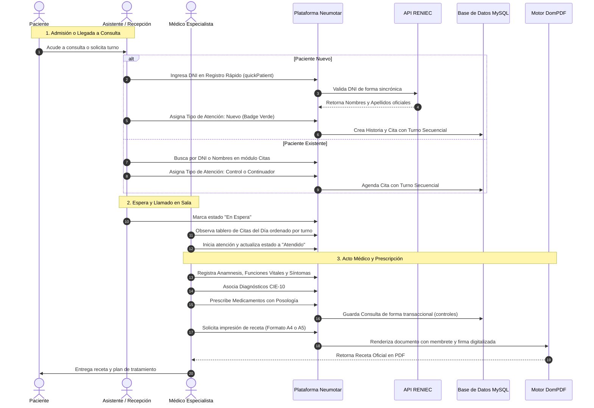

# Neumo-LAV / Neumotar

> **Plataforma Integral de Gestión de Historias Clínicas Electrónicas (HCL), Control de Citas y Turnos en Sala de Espera, Diagnósticos Neumológicos Especializados, Salud Ocupacional, Prescripción Farmacológica Dual (A4/A5) y Analítica Epidemiológica.**

[](https://laravel.com)
[](https://php.net)
[](https://www.mysql.com)
[](https://adminlte.io)
[](https://getbootstrap.com)
[]()

---

## Tabla de Contenidos

- [1. Descripción del Proyecto](#1-descripción-del-proyecto)
- [2. Capacidades y Características Clínicas](#2-capacidades-y-características-clínicas)
- [3. Arquitectura del Sistema](#3-arquitectura-del-sistema)
- [4. Estructura de Controladores y Módulos](#4-estructura-de-controladores-y-módulos)
- [5. Flujo Operativo y Ciclo de Vida del Paciente](#5-flujo-operativo-y-ciclo-de-vida-del-paciente)
- [6. Seguridad, RBAC, Credenciales Médicas y Auditoría](#6-seguridad-rbac-credenciales-médicas-y-auditoría)
- [7. Base de Datos: Modelos, Procedimientos Almacenados y Vistas](#7-base-de-datos-modelos-procedimientos-almacenados-y-vistas)
- [8. Servicios Especializados e Integraciones Externas](#8-servicios-especializados-e-integraciones-externas)
- [9. Requisitos del Entorno](#9-requisitos-del-entorno)
- [10. Guía de Instalación y Puesta en Marcha](#10-guía-de-instalación-y-puesta-en-marcha)
- [11. Usuarios y Roles Preconfigurados](#11-usuarios-y-roles-preconfigurados)
- [12. Copias de Seguridad y Tareas Programadas](#12-copias-de-seguridad-y-tareas-programadas)
- [13. Documento de Definición de Producto (PDR)](#13-documento-de-definición-de-producto-pdr)

---

## 1. Descripción del Proyecto

**Neumo-LAV** (denominado comercialmente en la atención de pacientes como **Neumotar**) es una solución informática médica de nivel empresarial diseñada específicamente para digitalizar, optimizar y auditar la gestión asistencial y administrativa de centros especializados en **Neumología, Medicina Respiratoria y Salud Ocupacional**. Concebido para la empresa **Medytarq SAC** en Tarapoto (San Martín, Perú), el sistema erradica el uso del papel mediante un ecosistema digital seguro, rápido y conforme a los estándares sanitarios del Ministerio de Salud (MINSA).

### Objetivos Clave y Alcance

1. **Filiación Asistida e Identidad Validada:** Conexión sincrónica con la base de datos de RENIEC (vía API REST Decolecta) para validación infalible del DNI y codificación geográfica normalizada según el estándar de Ubigeo nacional (1,874 distritos).
2. **Gestión de Flujo y Turnos en Espera (FIFO):** Tablero operativo en tiempo real en la página principal (`/admin/home`) con asignación secuencial de turnos, semaforización de estados (`En Espera`, `Atendido`, `Cancelado`, `Reagendado`) y categorización por tipo de atención (`Nuevo`, `Control`, `Continuador`).
3. **Registro Rápido de Pacientes (`quickPatient`):** Admisión express en una única transacción atómica para pacientes que requieren atención inmediata en mostrador.
4. **Evaluación de Factores de Riesgo Pulmonar:** Cálculo automático del **Índice Paquete Año (IPA)** para tabaquismo, detección de exposición a humo de biomasa/leña (propio de la Amazonía peruana) y trazabilidad de contacto con Tuberculosis (TBC) y COVID-19.
5. **Consultas Médicas y Recetas Duales (A4 / A5):** Formulación posológica de medicamentos vinculada a diagnósticos **CIE-10**, con generación e impresión instantánea de recetas médicas en formato institucional **A4** o recetario de bolsillo **A5** con membrete, logotipo y firma digitalizada del facultativo.
6. **Apoyo al Diagnóstico, Espirometría e Imagenología:** Registro de parámetros de función pulmonar (FEV1, FVC, FEV1/FVC basal y post-broncodilatador), almacenamiento multimedia de imágenes diagnósticas (radiografías de tórax, tomografías axiales computarizadas) y visor de imágenes integrado.
7. **Informes Médicos y Riesgo Quirúrgico:** Emisión estructurada de dictámenes clínicos oficiales y evaluaciones de riesgo quirúrgico neumológico/cardiovascular preoperatorio con clasificación ASA e índices predictivos.
8. **Analítica Epidemiológica en Tiempo Real:** Tableros interactivos desarrollados con Highcharts que visualizan morbilidad respiratoria, Top 15 de diagnósticos, Top 15 de medicamentos prescritos y métricas sociodemográficas.
9. **Portal Web y Reservas Omnicanal:** Portal web público con catálogo de servicios, blog divulgativo y solicitud de citas en línea con confirmación vía **WhatsApp Cloud API** y correo electrónico transaccional.

---

## 2. Capacidades y Características Clínicas

### 2.1 Módulo Operativo de Citas y Turnos (`CitasController`)

- **Control de Sala de Espera del Día:** Visualización cronológica y por turno (FIFO) de los pacientes agendados para la fecha seleccionada.
- **Métricas Instantáneas del Día:** Contadores dinámicos de total de citas, pacientes en espera física en sala, atendidos, pendientes y cancelados.
- **Tipos de Atención:** Distinción visual mediante badges interactivos:
  - <span style="color:#28a745; font-weight:bold;">Nuevo (Verde):</span> Primera consulta del paciente en el centro.
  - <span style="color:#007bff; font-weight:bold;">Control (Azul):</span> Cita de seguimiento o revisión de tratamiento.
  - <span style="color:#ffc107; font-weight:bold;">Continuador (Amarillo):</span> Paciente recurrente con tratamiento crónico en curso.
  - Cambio inmediato de tipo de atención con un clic desde la tabla de citas, sincronizando el estado tanto en la cita como en la historia clínica.
- **Reagendamiento Seguro:** Reprogramación de fecha y hora validando que el paciente no posea ya otra cita activa en el día destino, recalculando su turno de forma secuencial.
- **Acciones Directas desde Mostrador:** Menú contextual para abrir la historia, iniciar un nuevo control, registrar un examen auxiliar, emitir un informe o evaluar riesgo quirúrgico.

### 2.2 Historia Clínica Neumológica (HCL) (`HistoriesController`)

- **Validación RENIEC en Vivo:** Autocompletado de nombres completos a partir del número de DNI.
- **Cálculo Automatizado de Carga Tabáquica (IPA):**
  $$
  \text{IPA} = \frac{\text{Cigarrillos al día} \times \text{Años fumando}}{20}
  $$
- **Riesgo Ambiental Regional:** Exposición a humo de leña/biomasa en cocina tradicional y antecedentes de tuberculosis pulmonar (contacto intradomiciliario TBC).
- **Antecedentes Mórbidos:** Asma bronquial, EPOC, EPID, neoplasias pulmonares, efusión pleural y neumonías previas.
- **Resumen Clínico Rápido (`quickView`):** Modal que extrae en una sola llamada el resumen demográfico del paciente, sus últimas funciones vitales y su historial reciente de exámenes y controles.

### 2.3 Controles Médicos y Prescripción Farmacológica (`AppointmentsController`)

- **Anamnesis Evolutiva:** Tiempo de enfermedad, funciones vitales y relato cronológico de síntomas.
- **Diagnóstico Multivariado CIE-10:** Selección asistida por autocompletado de uno o varios diagnósticos por consulta.
- **Prescripción Posológica Detallada:** Selección de fármacos por principio activo, presentación y concentración con campos individuales para dosis, vía de administración, frecuencia y duración.
- **Impresión Dual en PDF:** Formato formal **A4** para el archivo clínico y formato **A5** (medio pliego) para recetario entregable al paciente, con membrete corporativo y firma digitalizada del médico especialista.

### 2.4 Exámenes Auxiliares e Imagenología (`ExamsController`)

- **Espirometría y Función Pulmonar:** Registro de curvas basales y post-broncodilatador con parámetros FEV1, FVC y ratio FEV1/FVC.
- **Paneles de Laboratorio y Fluidos:** Hemograma, bioquímica, perfil hepático, coagulación, reumatología, orina, esputo y análisis citoquímico de líquido pleural (ADA, PAP, cultivos bacteriológicos, BK directo).
- **Almacenamiento y Visor de Imágenes:** Carga de radiografías, tomografías y curvas gráficas asociadas al examen, con previsualización en ventana modal.

### 2.5 Informes Médicos e Informes de Riesgo Quirúrgico

- **Informes Clínicos (`ReportsController`):** Documentos médico-legales certificados para instituciones laborales, aseguradoras o referencias hospitalarias.
- **Riesgo Quirúrgico (`RisksController`):** Valoración preoperatoria neumológica y cardiovascular con clasificación de riesgo anestésico y recomendaciones perioperatorias en PDF.

### 2.6 Inteligencia Artificial Aplicada a Contenidos (`SummaryService`)

- Motor de resumen inteligente con fallback automático entre las APIs de **DeepSeek** y **Kimi AI**, orientado a sintetizar contenidos científicos y artículos de divulgación respiratoria.

---

## 3. Arquitectura del Sistema

El sistema implementa el patrón **Modelo-Vista-Controlador (MVC)** desacoplado sobre Laravel 10:

```
[Navegador / Terminal Consultorio / Recepción / Portal Web]
                             │
                             ▼
                 [Servidor Web Nginx / Apache]
                             │
                             ▼
  [Pipeline de Middleware: Autenticación, Rate Limiting, Anti-Caché, Auditoría]
                             │
                             ▼
                   [Capa de Controladores]
      ┌──────────────────────┬──────────────────────┬──────────────────────┐
      │                      │                      │                      │
[Citas & Recepción]    [Módulo Clínico]      [Mantenimiento & CMS]    [Seguridad & RBAC]
CitasController        HistoriesController   DrugsController          UsersController
HomeController         AppointmentsController CategoriesController    RolesController
                       ExamsController       DiagnosticsController    PermissionController
                       ReportsController     OccupationsController    SpecialtiesController
                       RisksController       EnterpriseController     AuthController
                       StatisticsController  PostsController          HomePageController
      └──────────────────────┼──────────────────────┴──────────────────────┘
                             │
                             ▼
                 [Capa de Servicios y Negocio]
      ├─► [SummaryService: Integración IA DeepSeek / Kimi]
      ├─► [TableViewService: Renderizado Dinámico de Tablas]
      ├─► [DomPDF Engine: Emisión de Recetas A4 / A5 con Firma Digital]
      ├─► [RENIEC API: Decolecta REST Client sincrónico]
      └─► [Mail & WhatsApp API: Notificaciones Transaccionales]
                             │
                             ▼
            [Capa de Persistencia Eloquent: 36 Modelos]
                             │
                             ▼
       [Base de Datos Relacional: MySQL 8.0+ / MariaDB 10.5+]
      ├─► 18 Procedimientos Almacenados (PA_*)
      ├─► 7 Vistas SQL Optimizadas (view_*, vista_*)
      └─► Auditoría Transaccional Automática (audit_logs)
```

---

## 4. Estructura de Controladores y Módulos

El código fuente de la aplicación se organiza bajo una estructura modular clara:

```
app/Http/Controllers/
├── ApplicationController.php              # Controlador base de aplicación
├── Controller.php                         # Clase abstracta base de Laravel
├── HomeController.php                     # Dashboard inicial y métricas generales
├── CitasController.php                    # Control de citas, turnos FIFO, tipos de atención y sala de espera
├── auth/
│   └── AuthController.php                 # Autenticación, Rate Limiting, sesión y prevención de caché
├── business/
│   ├── EnterpriseController.php           # Configuración institucional, geolocalización y 4 activos gráficos
│   └── PostsController.php                # CMS de divulgación respiratoria y artículos médicos
├── hcl/
│   ├── AppointmentsController.php         # Consultas de control, recetas médicas y PDFs A4/A5
│   ├── ExamsController.php                # Pruebas de función pulmonar, espirometría e imágenes médicas
│   ├── HistoriesController.php            # Historias clínicas, RENIEC DNI, ubigeos y modal quickView
│   ├── ReportsController.php              # Emisión y descarga de informes clínicos oficiales en PDF
│   ├── RisksController.php                # Evaluaciones de riesgo quirúrgico neumológico en PDF
│   └── StatisticsController.php           # Analítica epidemiológica y gráficos Highcharts
├── maintenance/
│   ├── CategoriesController.php           # Categorías y familias farmacológicas
│   ├── DiagnosticsController.php          # Catálogo maestro de patologías CIE-10
│   ├── DrugsController.php                # Vademécum activo de fármacos y principios activos
│   ├── OccupationsController.php          # Catálogo de ocupaciones y oficios CIUO
│   └── PresentationsController.php        # Formas y presentaciones farmacéuticas
├── security/
│   ├── ConfigController.php               # Configuración global del sistema
│   ├── PermissionController.php           # Catálogo de permisos del sistema
│   ├── RolesController.php                # Roles institucionales y sincronización dual-panel de permisos
│   ├── SpecialtiesController.php          # Especialidades médicas de los profesionales
│   └── UsersController.php                # Cuentas de usuario, reseteo de claves y perfil con CMP/RNE/firma
└── web/
    └── HomePageController.php             # Portal web público, artículos, contacto y reservas online
```

---

## 5. Flujo Operativo y Ciclo de Vida del Paciente



---

## 6. Seguridad, RBAC, Credenciales Médicas y Auditoría

### 6.1 Pipeline de Seguridad y Control de Caché

- **Protección contra Fuerza Bruta:** El método `AuthController@login` restringe el acceso tras 5 intentos fallidos consecutivos mediante hash transliterado de correo e IP (`Str::transliterate(Str::lower($email).'|'.$ip)`).
- **Protección de Privacidad Post-Logout (`PreventBackHistory` y `PreventBrowserCacheAfterLogout`):** Inyección obligatoria de cabeceras HTTP que impiden la visualización de datos médicos sensibles al utilizar el botón "Atrás" del navegador:
  ```http
  Cache-Control: no-cache, no-store, max-age=0, must-revalidate
  Pragma: no-cache
  Expires: Fri, 01 Jan 1990 00:00:00 GMT
  ```
- **Control Granular con Spatie Permission (`CheckPermission`):** Soporte de operadores lógicos OR (`|`) y listas delimitadas de permisos evaluadas directamente en rutas y controladores.

### 6.2 Roles Institucionales Preconfigurados

1. **Administrador (`administrador`):** Control total de seguridad, usuarios, roles, sincronización de permisos, auditoría, catálogos maestros y copias de seguridad.
2. **Especialista (`especialista`):** Perfil facultativo con acceso al circuito clínico completo: historias clínicas, atención de citas, emisión de recetas A4/A5, órdenes de exámenes auxiliares, informes de riesgo quirúrgico y dashboard epidemiológico.
3. **Asistente (`asistente`):** Perfil de recepción y triaje para admisión de pacientes, gestión de la cola de turnos, confirmación de citas y consulta de historias clínicas.

### 6.3 Perfil del Facultativo y Firma Digitalizada

A través de la ruta `/admin/profile` (`UsersController@profile` y `updateProfile`), cada especialista gestiona:

- Fotografía o avatar institucional.
- **Colegiatura Médica (CMP):** Número oficial del Colegio Médico del Perú.
- **Registro Nacional de Especialista (RNE):** Acreditación como especialista en Neumología o Medicina Respiratoria.
- **Firma Digitalizada (`firma_digital`):** Archivo gráfico de alta resolución almacenado en disco seguro (`storage/app/public/signatures/`) que se incrusta automáticamente en el pie de página de las recetas médicas, informes clínicos y evaluaciones de riesgo quirúrgico.

### 6.4 Trazabilidad y Auditoría Transaccional (`AuditLogTrait`)

El trait `AuditLogTrait` intercepta los eventos del ciclo de vida de los modelos (`created`, `updated`, `deleted`) y registra en la tabla `audit_logs`:

- Identificador del usuario responsable.
- Módulo y clave primaria afectada.
- Dirección IP y User-Agent del navegador.
- Instantánea en formato JSON del estado anterior (`old_data`) y del estado modificado (`new_data`), garantizando respaldo legal y auditoría inmutable.

---

## 7. Base de Datos: Modelos, Procedimientos Almacenados y Vistas

### 7.1 Modelos Eloquent del Sistema (36 Entidades)

| # | Modelo                    | Tabla                   | Relaciones y Propósito Principal                                                                          |
| :-: | :------------------------ | :---------------------- | :--------------------------------------------------------------------------------------------------------- |
| 1 | `Appointment`           | `controles`           | Consultas médicas de control, funciones vitales y anamnesis evolutiva.                                    |
| 2 | `AppointmentStatus`     | `estado_cita`         | Catálogo de estados de citas (`Pendiente`, `Atendido`, `Cancelado`, `En Espera`, `Reagendado`). |
| 3 | `AuditLog`              | `audit_logs`          | Registro inmutable de eventos de auditoría y trazabilidad transaccional.                                  |
| 4 | `BloodGroups`           | `grupo_sanguineo`     | Grupos sanguíneos y factor Rh.                                                                            |
| 5 | `Category`              | `droga_categoria`     | Categorías y familias farmacológicas.                                                                    |
| 6 | `Cita`                  | `citas`               | Turnos del día, cola de atención FIFO, fecha, hora, estado y tipo de atención.                          |
| 7 | `DegreesInstruction`    | `grado_instruccion`   | Niveles de instrucción académica.                                                                        |
| 8 | `Diagnostic`            | `diagnosticos`        | Catálogo internacional de enfermedades CIE-10.                                                            |
| 9 | `DiagnosticAppointment` | `control_diagnostico` | Diagnósticos asociados a una consulta médica de control.                                                 |
| 10 | `DiagnosticExam`        | `examen_diagnostico`  | Diagnósticos asociados a un examen auxiliar o espirometría.                                              |
| 11 | `DiagnosticReport`      | `informe_diagnostico` | Diagnósticos vinculados a un informe médico formal.                                                      |
| 12 | `DocumentType`          | `tipo_documento`      | Documentos de identidad oficiales (DNI, Carné de Extranjería, Pasaporte).                                |
| 13 | `Drug`                  | `drogas`              | Vademécum maestro de fármacos y principios activos.                                                      |
| 14 | `Enterprise`            | `empresa`             | Datos fiscales de Medytarq SAC, geolocalización y 4 recursos gráficos.                                   |
| 15 | `Exam`                  | `examenes`            | Pruebas diagnósticas, espirometrías, signos vitales y fluidos pleurales.                                 |
| 16 | `ExamType`              | `tipo_examen`         | Clasificación de exámenes (Espirometría, TAC, Radiografía, etc.).                                      |
| 17 | `History`               | `historias`           | Expediente clínico del paciente, factores ambientales, IPA y filiación.                                  |
| 18 | `Imagen`                | `imagenes`            | Archivos gráficos de exámenes (radiografías, trazados de espirometría, TAC).                           |
| 19 | `MaritalStatus`         | `estado_civil`        | Estados civiles del paciente.                                                                              |
| 20 | `MedicationAppointment` | `control_medicacion`  | Fármacos y posología prescritos en una consulta médica.                                                 |
| 21 | `MedicationExam`        | `examen_medicacion`   | Medicación administrada durante o después de un examen auxiliar.                                         |
| 22 | `Occupation`            | `ocupaciones`         | Clasificación de ocupaciones CIUO para riesgo respiratorio laboral.                                       |
| 23 | `Post`                  | `post`                | Artículos divulgativos y noticias en el blog del portal público.                                         |
| 24 | `PostType`              | `post_type`           | Categorías temáticas de publicaciones.                                                                   |
| 25 | `Presentation`          | `droga_presentacion`  | Formas farmacéuticas (Inhalador MDI, Polvo seco DPI, Tabletas, Jarabes).                                  |
| 26 | `Profile`               | `perfiles`            | Perfiles de configuración de usuario.                                                                     |
| 27 | `Report`                | `historia_informe`    | Informes médicos oficiales de neumología.                                                                |
| 28 | `Reservation`           | `reservations`        | Reservas de citas solicitadas desde la página web pública.                                               |
| 29 | `Risk`                  | `historia_riesgo`     | Evaluaciones de riesgo quirúrgico neumológico y cardiovascular.                                          |
| 30 | `Sex`                   | `sexo`                | Sexo biológico del paciente.                                                                              |
| 31 | `Smoking`               | `tabaquismo`          | Categorías de consumo de tabaco (`No fumador`, `Exfumador`, `Fumador`).                             |
| 32 | `Specialty`             | `especialidades`      | Especialidades médicas de los profesionales.                                                              |
| 33 | `TipoAtencion`          | `tipos_atencion`      | Catálogo de tipos de atención (`Nuevo`, `Control`, `Continuador`).                                 |
| 34 | `UbigeoDistrict`        | `ubigeo_distrito`     | Catálogo de distritos del Perú (Ubigeo nacional de 6 dígitos).                                          |
| 35 | `User`                  | `users`               | Cuentas de usuario con roles, credenciales médicas CMP/RNE y firma digital.                               |
| 36 | `UserLastLogin`         | `user_last_login`     | Registro del último acceso al sistema con fecha, hora y dirección IP.                                    |

### 7.2 Procedimientos Almacenados (18 PA_*)

- `PA_getAppointmentsByDni`: Consulta rápida de controles médicos por DNI.
- `PA_getAppointmentsByMedicalHistory`: Historial de consultas médicas por ID de historia.
- `PA_getDiagnosticByAppointment`: Diagnósticos CIE-10 asignados a una consulta médica.
- `PA_getDiagnosticByExam`: Diagnósticos asociados a un examen auxiliar.
- `PA_getDiagnosticByReport`: Diagnósticos incluidos en un informe médico formal.
- `PA_getExamsByDni` / `PA_getExamsByMedicalHistory`: Historial de exámenes auxiliares por DNI o ID de historia.
- `PA_getImgByExam`: Imágenes y trazados radiológicos vinculados a un examen.
- `PA_getMedicalHistoryByAppointment`: Datos de filiación del paciente a partir de la consulta médica.
- `PA_getMedicalHistoryByExam` / `PA_getMedicalHistoryByReport` / `PA_getMedicalHistoryByRisk`: Filiación para membretes de documentos clínicos oficiales.
- `PA_getMedicationByAppointment`: Fármacos y posología prescritos en una cita médica.
- `PA_getMedicationByExam`: Fármacos vinculados a un procedimiento diagnóstico.
- `PA_getReportsByDni` / `PA_getReportsByMedicalHistory`: Historial de informes clínicos emitidos.
- `PA_getRisksByDni` / `PA_getRisksByMedicalHistory`: Historial de evaluaciones de riesgo quirúrgico.

### 7.3 Vistas SQL Optimizadas (7 Vistas)

- `view_active_drugs`: Vademécum activo uniendo categoría, descripción y presentación farmacéutica.
- `view_active_histories`: Pacientes vigentes con cálculo de edad cronológica exacta a la fecha.
- `view_active_users`: Usuarios activos y la fecha de su último acceso al sistema.
- `view_user_roles_last_login`: Usuarios, roles asignados y último acceso registrado.
- `vista_estado_civil` / `vista_grupo_sanguineo` / `vista_tabaquismo`: Métricas demográficas agregadas para gráficos Highcharts.

---

## 8. Servicios Especializados e Integraciones Externas

### 8.1 Validación de Identidad RENIEC en Tiempo Real

- Conexión vía cliente HTTP con la API REST de **Decolecta** (`https://api.decolecta.com/v1/reniec/dni?numero={dni}`).
- Recupera en milisegundos nombres, apellidos paterno y materno oficiales, garantizando cero errores de transcripción en expedientes clínicos.

### 8.2 Motor de Notificaciones WhatsApp Cloud API

- Implementado a través del paquete `netflie/whatsapp-cloud-api`.
- Vinculado a la API oficial de Meta para confirmación automática de citas solicitadas por el portal público.

### 8.3 Resumen Inteligente con IA (DeepSeek / Kimi AI)

- Servicio `SummaryService` con arquitectura de tolerancia a fallos:
  1. Intenta consulta a **DeepSeek API** con timeout estricto de 15 segundos.
  2. En caso de fallo o timeout, conmuta automáticamente a **Kimi AI**.
  3. Si ambas fallan, retorna `null` de forma controlada sin interrumpir el flujo.

### 8.4 Motor de Renderizado de Recetas PDF A4 y A5

- Implementado mediante `barryvdh/laravel-dompdf`.
- Emisión dual adaptada a estándares de archivo clínico (A4) o recetario de mano (A5) con membrete institucional, logotipo, fecha, datos del paciente, prescripción posológica y firma digitalizada del médico tratante.

---

## 9. Requisitos del Entorno

- **PHP:** Versión `8.1` o superior (probado en PHP `8.3`).
- **Extensiones PHP obligatorias:** `pdo_mysql`, `mbstring`, `openssl`, `tokenizer`, `xml`, `ctype`, `json`, `bcmath`, `curl`, `fileinfo`, `gd`.
- **Servidor de Base de Datos:** MySQL `8.0+` o MariaDB `10.5+`.
- **Gestor de Paquetes:** Composer `2.2+`.
- **Servidor Web:** Nginx o Apache con módulo `mod_rewrite` habilitado.
- **Almacenamiento:** Permisos de lectura/escritura en directorios `storage/` y `bootstrap/cache/`.

---

## 10. Guía de Instalación y Puesta en Marcha

### Paso 1: Clonación del Repositorio

```bash
git clone <url-del-repositorio> neumo-lav
cd neumo-lav
```

### Paso 2: Instalación de Dependencias PHP

```bash
composer install --no-interaction --prefer-dist --optimize-autoloader
```

### Paso 3: Configuración del Archivo de Entorno

```bash
cp .env.example .env
php artisan key:generate
```

Edite el archivo `.env` y configure las credenciales de base de datos y servicios:

```ini
DB_CONNECTION=mysql
DB_HOST=127.0.0.1
DB_PORT=3306
DB_DATABASE=neumotar_db
DB_USERNAME=root
DB_PASSWORD=su_clave_segura

# Correo Transaccional
MAIL_MAILER=smtp
MAIL_HOST=smtp.gmail.com
MAIL_PORT=587
MAIL_USERNAME=su_correo@gmail.com
MAIL_PASSWORD=su_clave_aplicacion
MAIL_ENCRYPTION=tls

# APIs de Inteligencia Artificial (Opcional)
DEEPSEEK_API_KEY=sk-...
KIMI_API_KEY=...
```

### Paso 4: Ejecución de Migraciones y Poblado de Datos

El proyecto incluye migraciones para tablas, procedimientos almacenados y vistas SQL:

```bash
# Crear estructura de tablas, procedimientos almacenados y vistas
php artisan migrate

# Poblar catálogos maestros, ubigeos nacionales, roles y empresa
php artisan db:seed
```

### Paso 5: Enlace Simbólico del Almacenamiento

Para habilitar el acceso a imágenes de exámenes, firmas digitales y logotipos:

```bash
php artisan storage:link
```

### Paso 6: Optimización y Limpieza de Caché

```bash
php artisan config:cache
php artisan route:cache
php artisan view:cache
```

### Paso 7: Inicio del Servidor de Desarrollo

```bash
php artisan serve
```

Acceda a la aplicación mediante su navegador en `http://127.0.0.1:8000`.

---

## 11. Usuarios y Roles Preconfigurados

Tras ejecutar los seeders del sistema (`DatabaseSeeder`), se habilitan los siguientes perfiles de acceso:

| Rol Asignado            | Correo Electrónico        | Contraseña Predeterminada | Alcance                                                                            |
| :---------------------- | :------------------------- | :------------------------- | :--------------------------------------------------------------------------------- |
| **Administrador** | `admin@neumotar.com`     | `password`               | Configuración, seguridad, roles, usuarios, catálogos y módulos clínicos.       |
| **Especialista**  | `medico@neumotar.com`    | `password`               | Consultas médicas, recetas A4/A5, exámenes, informes, firma digital y dashboard. |
| **Asistente**     | `asistente@neumotar.com` | `password`               | Admisión de pacientes, asignación de turnos, registro rápido y sala de espera.  |

> **Nota de Seguridad:** Se recomienda cambiar inmediatamente las contraseñas predeterminadas tras la puesta en producción desde el módulo de seguridad o desde la vista de perfil `/admin/profile`.

---

## 12. Copias de Seguridad y Tareas Programadas

El sistema integra `spatie/laravel-backup` para el resguardo periódico de la base de datos y de las imágenes médicas:

```bash
# Ejecutar respaldo de la base de datos exclusivamente
php artisan backup:run --only-db

# Ejecutar respaldo completo (Base de Datos + Archivos de Storage)
php artisan backup:run

# Monitorear estado de los respaldos
php artisan backup:monitor

# Limpiar respaldos antiguos según política de retención
php artisan backup:clean
```

Para automatizar las copias nocturnas, añada la siguiente entrada en el `crontab` de su servidor Linux:

```cron
0 2 * * * cd /ruta/al/proyecto && php artisan backup:run --only-db >> /dev/null 2>&1
```

---

## 13. Documento de Definición de Producto (PDR)

Para consultar la especificación técnica pormenorizada, el diccionario completo de las 36 entidades de datos, la matriz exhaustiva de las más de 85 rutas del sistema, la lógica detallada de cada controlador y los diagramas de secuencia clínica, revise el documento:

- **[Documento de Definición de Producto y Reporte de Arquitectura (PDR)](docs/PDR.md)** (Versión canónica en directorio `docs/`)
- También disponible en la raíz del repositorio como [`PDR.md`](PDR.md).

---

**Desarrollado para:** Medytarq SAC / Neumotar
**Tarapoto, San Martín, Perú**
